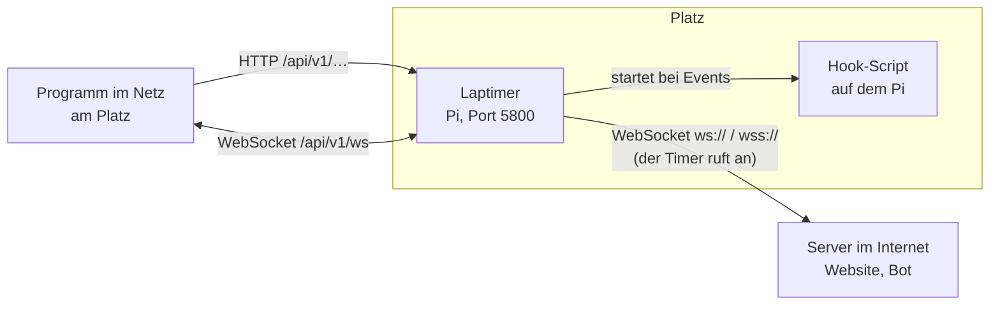
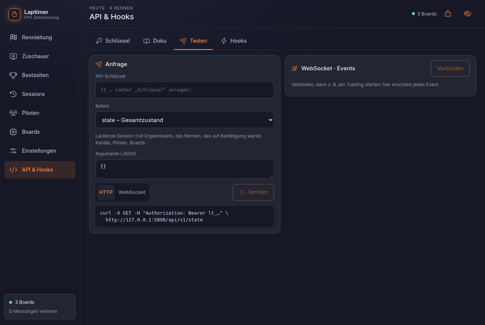

# API

Der Laptimer soll mit anderen Dingen zusammenspielen: ein Stream-Overlay, ein Discord-Bot,
ein Taster am Gate, LEDs am Pi, eine Website mit den Ergebnissen. Alles, was die Seite kann,
geht auch über die API, und jedes Ereignis am Platz kommt live als **Event**.

## Vier Wege



| Weg | Wer verbindet sich | Gut für | Seite |
|---|---|---|---|
| **HTTP** | dein Programm → Timer | einzelne Befehle: Rennen starten, Piloten zuteilen, Ergebnis holen; ein Taster am Gate | [HTTP](http.md) |
| **WebSocket** | dein Programm → Timer | Events live mitlesen und Befehle schicken, über eine Verbindung: Overlay, Anzeige, Bot am Platz | [WebSocket](websocket.md) |
| **Server-Verbindung** | Timer → dein Server | ein Server, der immer läuft und den Timer nicht erreichen kann (der Timer steht hinter dem Router am Platz) | [Server-Verbindung](server-verbindung.md) |
| **Hooks** | Timer startet ein Script | Dinge direkt am Pi: LED am GPIO, Datei schreiben, kurze Shell-Scripts | [Hooks](hooks.md) |

Alle vier sprechen dieselbe Sprache:

- Jede Aktion ist ein **Befehl** mit Namen und JSON-Argumenten, z. B. `session.start` mit
  `{"race": true}`. Derselbe Befehl geht per HTTP, über den WebSocket und über die
  Server-Verbindung. Liste: [Befehle](befehle.md).
- Jedes Ereignis ist ein **Event** mit Namen und Daten, z. B. `pilot_pass`. Es geht an alle
  WebSockets, über die Server-Verbindung und an die Hooks. Was wann kommt: [Events](events.md).
- Die Objekte darin (Kanal, Session, Ergebnis, Zustand): [Datenformate](datenformate.md).

Fertige Clients für Python und JavaScript nehmen einem Verbindung, Neuverbinden und Fehler ab,
beide als Paket `fpv-laptimer-client`:

| Sprache | Installieren | Paket | Quellcode |
|---|---|---|---|
| Python ≥ 3.10 | `pip install "fpv-laptimer-client[events]"` | [PyPI](https://pypi.org/p/fpv-laptimer-client) | [`fpv-laptimer-client-python`](https://github.com/bli-blu-bla/fpv-laptimer-client-python) |
| JavaScript (Node ≥ 22, Browser) | `npm install fpv-laptimer-client` | [npm](https://www.npmjs.com/package/fpv-laptimer-client) | [`fpv-laptimer-client-js`](https://github.com/bli-blu-bla/fpv-laptimer-client-js) |

Beispiele: [Clients](clients.md).

## Schlüssel

Alles unter `/api/v1` braucht einen API-Schlüssel (`lt_` und 40 Hex-Zeichen). Anlegen auf der
Seite *API & Hooks → Schlüssel*; er wird nur einmal angezeigt (gespeichert ist nur sein
sha256). Löschen sperrt alle Programme, die ihn benutzen.

Mitschicken auf eine dieser Arten:

```
Authorization: Bearer lt_…
X-API-Key: lt_…
?key=lt_…            (z. B. für WebSockets aus dem Browser, der keine Header setzen kann)
```

Ohne gültigen Schlüssel: `401 {"error": "…"}`. Die Server-Verbindung und die Hooks brauchen
keinen Schlüssel: die richtet man auf der Seite ein, mit Login.

Die Weboberfläche selbst nutzt `/api` ohne Schlüssel, aber mit dem Passwort der Rennleitung
(`[auth]` in `~/.laptimer/config.toml`): Lesen geht ohne, alles Ändernde (auch Schlüssel und
Hooks anlegen) nur nach dem Login. Nur wer das Passwort kennt, kann also Schlüssel anlegen.
Mit `[auth] enabled = false` kann das jeder im Netz.

Der Server spricht HTTP, nicht HTTPS (lokales Netz am Platz, ohne Internet). Wer HTTPS
braucht, stellt einen Reverse-Proxy davor (z. B. Caddy).

## Die Seite API & Hooks

In der Seitenleiste, am Handy über einen Knopf in den Einstellungen. Reiter:

- **Schlüssel**: anlegen, löschen.
- **Doku**: Kurzreferenz aller Befehle und Events.
- **Testen**: jeden Befehl per HTTP oder WebSocket abschicken, mit der passenden curl-Zeile und
  einem Log aller Events, die gerade kommen.
- **Hooks**: Scripts Events zuordnen, letzte Läufe.
- **Server**: die Server-Verbindung.

{ .shot }

## Zeiten und Kanäle

- Zeiten sind ganze **µs seit 1970** (Wanduhr des Timers), Dauern ganze µs; Felder mit `_s`
  sind dieselbe Dauer in Sekunden, zum Anzeigen.
- Kanäle (Slots) werden über ihren **`index`** angesprochen: 0 = erster Kanal, wie Slot 1 auf
  der Seite.
- Fehlermeldungen sind deutsch und zum direkten Anzeigen gedacht.
