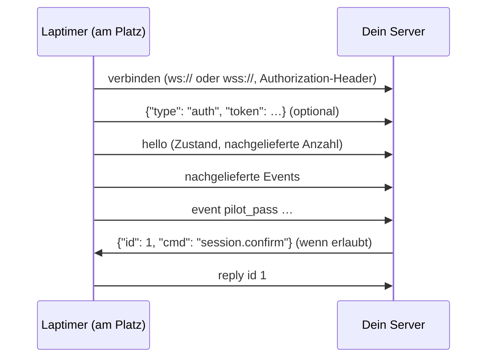
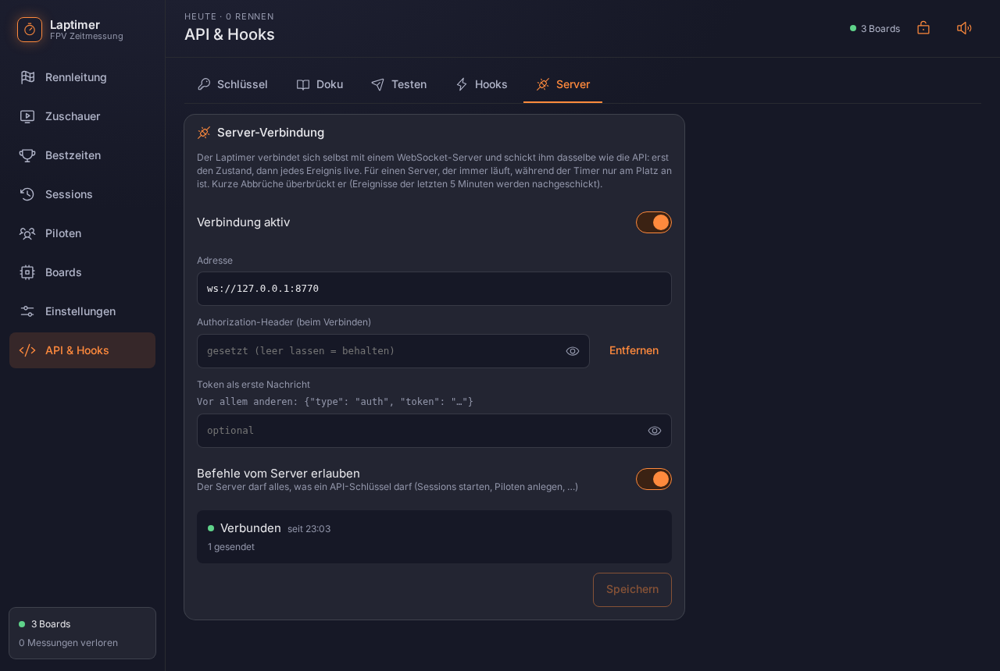

# Server-Verbindung: der Timer ist der Client

Beim [WebSocket](websocket.md) verbindet sich dein Programm zum Timer. Hier ist es
umgekehrt: Der Laptimer baut selbst eine WebSocket-Verbindung zu deinem Server auf und
schickt ihm alles live.

Gedacht für einen Server, der immer läuft (Website mit Ergebnissen, Discord-Bot, Auswertung
zu Hause), während der Timer nur am Platz an ist. Der Server muss den Timer dann nicht
erreichen können: der steht meist hinter dem Router am Platz, ohne feste Adresse. Es reicht,
dass der Timer ins Internet kommt (oder den Server im Netz sieht).



## Einstellen

Auf der Seite unter **API & Hooks → Server** (mit Login):

| Feld | |
|---|---|
| Adresse | `ws://…` oder `wss://…` (TLS) |
| Authorization-Header | optional: geht beim Verbindungsaufbau als `Authorization: <wert>` mit, so wie eingegeben (`Bearer abc123`, `Basic …`) |
| Token als erste Nachricht | optional: direkt nach dem Verbindungsaufbau, vor allem anderen, schickt der Timer `{"type": "auth", "token": "…"}` (für Server, die keine Header lesen) |
| Befehle vom Server erlauben | an: der Server darf alles, was ein API-Schlüssel darf; aus: Befehle werden mit `403` beantwortet |

Header und Token gehen einzeln oder zusammen. Die Seite zeigt beide nie wieder an, nur ob sie
gesetzt sind. Einen API-Schlüssel braucht diese Verbindung nicht.

{ .shot }

## Protokoll

Auf der Verbindung läuft **dasselbe Protokoll wie bei `/api/v1/ws`**, nur dass der Timer
anruft. `→` schickt der Timer, `←` der Server:

```
→ {"type": "auth", "token": "…"}                      (nur mit „Token als erste Nachricht“)
→ {"type": "hello", "api": 1, "version": "0.2.0", "state": {…}, "commands": […], "buffered": 0}
→ {"type": "event", "event": "pilot_pass", "seq": 17, "time_us": …, "data": {…}}
← {"id": 1, "cmd": "session.start", "args": {"race": true}}
→ {"type": "reply", "id": 1, "ok": true, "data": {…}}
```

- `hello`, `event` und `reply` sind genau wie beim [WebSocket](websocket.md#nachrichten-vom-timer);
  `hello` hat zusätzlich `buffered` (siehe unten). Die Events: [Events](events.md).
- Befehle schickt der Server wie ein Client beim WebSocket (`{"id", "cmd", "args"}`), die
  Liste: [Befehle](befehle.md). Mit „Befehle erlauben“ aus antwortet der Timer
  `{"type": "reply", "id": …, "ok": false, "status": 403, "error": "…"}`.
- Andere Nachrichten des Servers (JSON ohne `cmd`, etwa eine Bestätigung der Anmeldung)
  ignoriert der Timer.
- Ein `User-Agent: laptimer/<version>` kommt beim Verbindungsaufbau mit.
- Lehnt der Server ab, schließt er die Verbindung (z. B. Close-Code 4001) oder antwortet beim
  Aufbau mit einem HTTP-Fehler; die Seite zeigt Code und Grund.

## Abbrüche und Nachliefern

- **Neu verbinden:** Der Timer versucht es nach 2 s wieder, dann mit wachsendem Abstand bis
  30 s. Alle 30 s schickt er einen Ping; hört er 75 s nichts vom Server, gilt die Verbindung
  als tot und er baut sie neu auf.
- **Nachliefern:** Events ohne Verbindung hält er im Speicher, höchstens 5 Minuten und 2000
  Stück, und schickt sie direkt nach dem nächsten `hello` hinterher. `buffered` im `hello` sagt,
  wie viele folgen; sie tragen ihr ursprüngliches `seq` und `time_us`. `state` im `hello` ist
  schon der Stand *nach* diesen Events.
- Ältere Events verfallen: die Verbindung ist für Live-Daten gedacht, nicht als lückenloses
  Protokoll. Nach einem Neustart des Timers beginnt `seq` wieder bei 1, und was im Speicher
  lag, ist weg. Wer jedes Ergebnis braucht, holt es nach dem Verbinden mit `sessions.list` /
  `sessions.get`.

**Status** auf der Seite: verbunden, verbinde, getrennt mit Grund (z. B. `HTTP 401` oder der
Close-Code des Servers), gesendet, wartend, verworfen. Für Programme: `GET /api/remote` (nur mit
Login, weil dort die Einstellungen stehen; Header und Token selbst gibt es nicht zurück).

## TLS

`wss://` geht ohne weitere Einstellung. Der Timer vertraut nur Zertifikaten öffentlicher
Zertifizierungsstellen (z. B. Let's Encrypt), keinem selbst signierten.

## Ein minimaler Server

In Python (`pip install websockets`):

```python
import asyncio, json, websockets

async def timer(ws):
    # Entweder der Header …
    if ws.request.headers.get("Authorization") != "Bearer geheim":
        # … oder der Token als erste Nachricht.
        first = json.loads(await ws.recv())
        if first.get("type") != "auth" or first.get("token") != "geheim":
            return await ws.close(4001, "token")
    async for msg in ws:
        m = json.loads(msg)
        if m["type"] == "hello":
            print("Timer", m["version"], "verbunden,", m["buffered"], "Events nachgeliefert")
        elif m["type"] == "event" and m["event"] == "pilot_pass":
            print(m["data"]["pilot"], m["data"]["lap_time_s"])

async def main():
    async with websockets.serve(timer, "0.0.0.0", 8770):
        await asyncio.Future()

asyncio.run(main())
```

Etwas ausführlicher, mit `wss://` und Ausgabe jeder Nachricht:
[`tools/remote_server.py`](https://github.com/bli-blu-bla/fpv-laptimer/blob/main/tools/remote_server.py)
im Repo (`--token`, `--cert`/`--key`).
