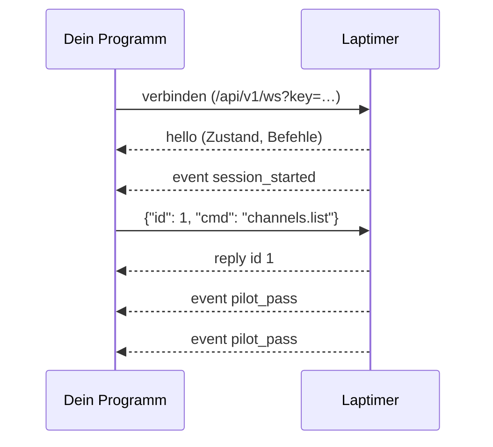

# WebSocket

Eine dauerhafte Verbindung von deinem Programm zum Timer: Der Timer schickt jedes
[Event](events.md) live, und du kannst über dieselbe Verbindung [Befehle](befehle.md)
schicken. Gut für alles, was mitlaufen soll: Overlay, Anzeige, Bot, Auswertung am Platz.

```
ws://<pi>:5800/api/v1/ws?key=lt_…
```

Der [Schlüssel](index.md#schlüssel) geht als `?key=` (Browser können beim WebSocket keine
Header setzen) oder als `Authorization`-/`X-API-Key`-Header. Ohne gültigen Schlüssel lehnt der
Server den Verbindungsaufbau mit 401 ab.

## Ablauf



1. Gleich nach dem Verbinden kommt **`hello`** mit dem ganzen Zustand. Ab diesem Moment
   verpasst du nichts: der Server abonniert die Events, *bevor* er den Zustand liest.
2. Danach kommt jedes **Event**, in der Reihenfolge, in der es entsteht.
3. Dazwischen beantwortet er deine **Befehle** mit `reply`, einen nach dem anderen.

Alle Nachrichten sind JSON-Text; welche es ist, sagt `type`.

## Nachrichten vom Timer

| type | wann | Inhalt |
|---|---|---|
| `hello` | einmal, gleich nach dem Verbinden | `api` (Version der API, jetzt `1`), `version` (des Laptimers), `state` (wie der Befehl `state`, siehe [Datenformate](datenformate.md#state)), `commands` (alle Befehlsnamen) |
| `event` | jedes Ereignis | `event`, `seq`, `time_us`, `data`, siehe [Events](events.md) |
| `reply` | Antwort auf einen deiner Befehle | `id`, `ok`, dann `data` oder `status` + `error` |
| `lagged` | dein Programm hat zu langsam gelesen | `missed`: so viele Events sind verloren |

```json
{"type": "hello", "api": 1, "version": "0.2.0", "state": {…}, "commands": ["ping", "state", …]}
```

## Befehle schicken

```
← {"id": 1, "cmd": "session.start", "args": {"race": true}}
→ {"type": "reply", "id": 1, "ok": true, "data": {…}}
← {"id": 2, "cmd": "session.start"}
→ {"type": "reply", "id": 2, "ok": false, "status": 400, "error": "Es läuft schon eine Session – erst stoppen."}
```

- `id` ist frei wählbar (Zahl oder Text) und kommt in der Antwort zurück; so ordnest du
  Antworten zu. `args` darf fehlen.
- `status` bei Fehlern wie per [HTTP](http.md#antworten): 400 abgelehnt, 404 unbekannter
  Befehl. Eine Nachricht, die gar kein Befehl ist, bekommt 400 mit `id: null`.
- Während ein Befehl läuft, warten die Events dieser Verbindung. Löst er selbst Events aus
  (z. B. `session.start` → `session_started`), kommt also erst das `reply`, dann die Events.
  Andere Verbindungen bekommen die Events unabhängig davon.

## Verbindung halten

- **Abbruch**: Der Timer merkt sich keine Clients. Nach einem Abbruch (WLAN weg, Neustart,
  Update) einfach neu verbinden; das neue `hello` bringt den aktuellen Stand, Events von
  dazwischen kommen nicht nach. Ein Neustart des Timers setzt `seq` auf 1 zurück.
- **Lücken**: Steigt `seq` um mehr als 1, oder kommt `lagged`, fehlen Events. Dann den Zustand
  neu holen (Befehl `state`, bei einer Session `sessions.get`).
- **Ping/Pong** beantwortet der Server von selbst; er schickt selbst keine Pings.
- Wer Events nachgeliefert haben will (Server, der den Timer nicht immer erreicht), nimmt die
  [Server-Verbindung](server-verbindung.md).

## Beispiele

**Python** (Paket `websockets`): alle Events mitlesen, ein Rennen starten, am Ende bestätigen

```python
import asyncio, json, websockets

async def main():
    async with websockets.connect("ws://pi:5800/api/v1/ws?key=lt_…") as ws:
        hello = json.loads(await ws.recv())
        print("verbunden, Session:", hello["state"]["session"])
        await ws.send(json.dumps({"id": 1, "cmd": "session.start", "args": {"race": True, "laps": 3}}))
        async for text in ws:
            msg = json.loads(text)
            if msg["type"] == "event" and msg["event"] == "pilot_pass" and msg["data"]["kind"] == "lap":
                d = msg["data"]
                print(f'{d["pilot"]}: Runde {d["lap"]} in {d["lap_time_s"]:.2f} s')
            elif msg["type"] == "event" and msg["event"] == "session_stopped" and msg["data"]["needs_confirmation"]:
                await ws.send(json.dumps({"id": 2, "cmd": "session.confirm"}))

asyncio.run(main())
```

**JavaScript** (Browser oder Node ≥ 22):

```js
const ws = new WebSocket('ws://pi:5800/api/v1/ws?key=lt_…')
ws.onmessage = (e) => {
  const m = JSON.parse(e.data)
  if (m.type === 'event') console.log(m.event, m.data)
}
ws.onopen = () => ws.send(JSON.stringify({ id: 1, cmd: 'channels.set', args: { index: 0, pilot: 'NITRO' } }))
```

Neuverbinden, Zuordnen der Antworten und Lücken nehmen dir die [Clients](clients.md) ab.
