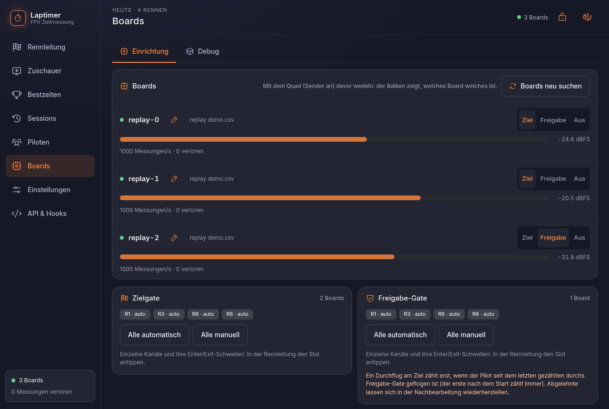

# Boards und Debug

## Einrichtung

**Boards → Einrichtung** zeigt alle angesteckten ESP32-C5 mit Live-Pegel, Rolle (Ziel,
Freigabe, Aus) und Namen. Später eingesteckte Boards findet **Boards neu suchen**. Darunter
stehen beide Gates mit dem Erkennungsmodus jedes Kanals und „Alle automatisch / Alle manuell“.

{ .shot }

**Firmware** spielt man ebenfalls hier auf, auch vom Handy aus: Der Server flasht ein Board,
das an ihm steckt, in etwa 10 s, und vergleicht danach die Version. Am Rechner mit Chrome oder
Edge geht es auch direkt aus dem Browser (Web Serial, nur über `localhost` oder HTTPS).
„veraltet“ steht neben einem Board nur, wenn seine Firmware älter ist als die, die der Laptimer
mitbringt.

Die Firmware hat außerdem eine eigene Seite:
**[bli-blu-bla.github.io/fpv-laptimer-firmware](https://bli-blu-bla.github.io/fpv-laptimer-firmware/)**.
Dort spielt man an jedem Rechner mit Chrome oder Edge die neueste Firmware auf, sieht Version
und Pegel eines Boards, gibt ihm einen Namen und schickt Befehle über eine Konsole.

## Debug

Wenn ein Durchflug fehlt oder einer zu viel kommt, will man wissen, warum. **Boards → Debug**
zeigt pro Kanal einen Graph mit mehreren Serien übereinander:

- **Ziel kombiniert**: das, was zählt
- **Freigabe kombiniert**, falls vorhanden
- **jedes Board allein**: Hat ein Board den Piloten nicht gesehen? Liegt eines falsch?

Zu jeder Serie lassen sich Schwellen und erkannte Durchflüge einblenden. Die Tabelle darunter
legt die Durchflüge der Serien nebeneinander (innerhalb 1 s = derselbe) und zeigt den Abstand
zum kombinierten Ziel. So sieht man, ob ein Board immer früher oder später dran ist.

{ .shot }

Quellen:

- **Live**: die letzten 3 Minuten, mit Anhalten und Zurückblättern
- **Aufnahme**: mit **Aufnehmen** schreibt der Server alle Pegel in eine Datei, die später
  hier oder mit `laptimer replay` neu ausgewertet werden kann
- **Session**: die Pegel-Datei einer gespeicherten Session

Die Debug-Ansicht hat ihre eigenen Detektoren mit denselben Einstellungen; sie ändert nichts
an den Runden.

## Debug-Paket

Für eine genauere Analyse (oder einen Fehlerbericht) exportiert **Sessions → ⤓ → Debug**
eine Session als `.tar.gz`: Einstellungen, alle Durchflüge auch gelöschte, Rohpegel, den
Verlauf der Erkennung je 10 ms und eine Neuberechnung mit den Session-Einstellungen. Siehe
[Durchflug-Erkennung](../technik/erkennung.md).
