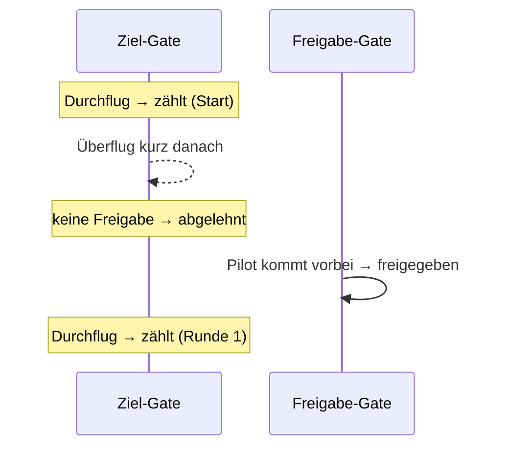

# Zwei Gates: Ziel und Freigabe

## Das Problem

Am Ziel-Gate misst der Laptimer nur den Pegel. Er kann nicht unterscheiden, ob die Drohne
durchs Gate flog, knapp darüber oder daneben. In einer Testsession flog ein Pilot oft 1–2 m
über dem Gate; diese Überflüge waren am Pegel kaum von echten Durchflügen zu unterscheiden. Und wer nach
dem Ziel umdreht und noch einmal durchfliegt, hätte eine sehr kurze Runde.

## Die Lösung: ein zweites Gate vor dem Ziel

Ein weiteres Board steht ein Stück vor dem Ziel-Gate auf der Strecke. Es ist das
**Freigabe-Gate** (englisch oft „arming gate“). Die Regel:

> Ein Durchflug am Ziel zählt nur, wenn der Pilot seit seinem letzten gezählten Durchflug am
> Freigabe-Gate vorbeikam.

Der erste Durchflug nach dem Start zählt immer.

Abgelehnte Durchflüge gehen nicht verloren: Sie werden als gelöscht gespeichert, mit dem Grund.
Die Durchflug-Liste der Rennleitung zeigt sie als „zählt nicht · Keine Freigabe“; dort oder im
[Editor](korrigieren.md) lassen sie sich mit einem Tipp wiederherstellen, falls das
Freigabe-Board den Piloten einmal nicht gesehen hat.

## Wo das Freigabe-Gate hinkommt

Am einfachsten **vor dem Ziel, mit gutem Abstand**: Die Piloten fliegen erst durchs
Freigabe-Gate, dann durchs Ziel. Weiter weg, etwa auf halber Runde, wäre zwar auch möglich,
aber alle Boards hängen per USB am selben Rechner, und so lange Kabel sind unpraktisch (USB 2.0
ist ohne aktive Verlängerung für höchstens 5 m gedacht).

Der Abstand ist wichtig: Das Freigabe-Board darf einen Durchflug am Ziel nicht selbst als
Vorbeiflug erkennen, sonst gibt jeder Durchflug am Ziel gleich wieder frei, und die Regel
greift nicht. Ob der Abstand reicht, zeigt **Boards → Debug**: Bei einem Durchflug am Ziel
sollte die Serie des Freigabe-Boards keinen eigenen Durchflug melden. Hilft mehr Abstand nicht,
kann man für das Freigabe-Gate den Mindestausschlag erhöhen oder feste Schwellen setzen.

## Einrichten

Unter **Boards → Einrichtung** bekommt jedes Board eine Rolle: **Ziel**, **Freigabe** oder
**Aus**. Mehrere Boards an einem Gate werden zusammengefasst (der höhere Pegel zählt). Neben
jedem Board steht sein Live-Pegel; wer die Drohne an ein Board hält, sieht sofort, welches
es ist. Namen für die Boards werden auf dem Board selbst gespeichert und überstehen
Umstecken und Flashen.

{ .shot }

Beide Gates haben ihre eigene Erkennung: automatisch gelernte Schwellen oder feste Werte, pro
Kanal einstellbar. Fällt das Freigabe-Board aus, gilt die Regel nicht, und das Ziel zählt
wie ohne Freigabe-Gate.

## Gut zu wissen

- Das Freigabe-Gate macht keine Runden; es gibt nur frei.
- In der Rennleitung zeigt das Schwellen-Panel eines Slots (Karte antippen) wahlweise den
  Pegel am Ziel- oder am Freigabe-Gate, jeweils mit seinen Schwellen.
- Die Pegel-Datei der Session enthält alle Boards mit ihren Rollen; der Editor kann das
  Freigabe-Gate deshalb auch nachträglich einblenden.
- Die Freigabe-Regel ist bisher nur mit Aufnahmen getestet, noch nicht auf einer echten
  Strecke. Welcher Abstand zum Ziel reicht, ist noch nicht gemessen.
