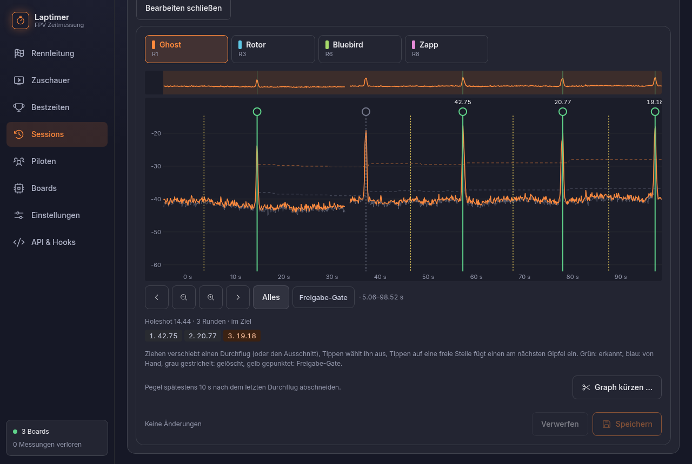
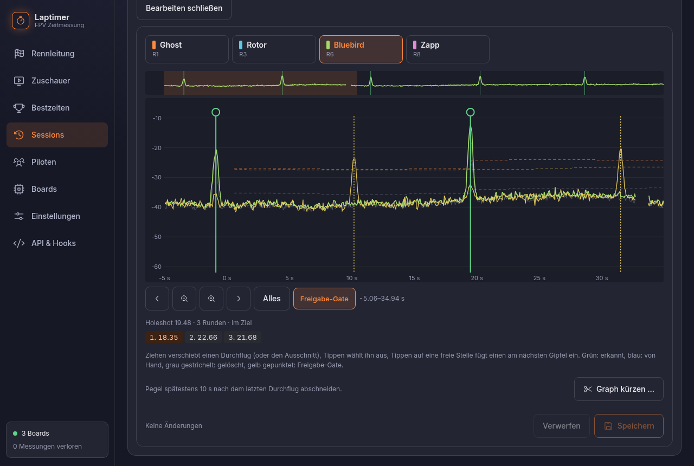

# Runden korrigieren

Ein verpasster Durchflug, ein Überflug, der mitgezählt hat: Bei anderen Systemen heißt das
oft Zettel und Stift. Hier hat jede Session ihren vollständigen Signalverlauf, und
korrigiert wird direkt im Graph, nach dem Rennen in der Rennleitung oder später unter
**Sessions → Runden bearbeiten**.

<figure markdown>
{ .shot }
<figcaption>Die ganze Session eines Piloten. Der grau gestrichelte Durchflug bei 37 s wurde
abgelehnt (das Freigabe-Gate hatte den Vorbeiflug davor verpasst), deshalb die erste Runde von
42,75 s. Antippen und „Wiederherstellen“ macht daraus zwei Runden um 20 s.</figcaption>
</figure>

## Bedienung

Oben den Kanal wählen. Darunter der Graph mit dem Pegel und den Durchflügen als senkrechte
Linien, mit Übersicht der ganzen Session und einem Ausschnitt zum Arbeiten.

| Geste | Wirkung |
|---|---|
| Durchflug **ziehen** | verschieben |
| Durchflug **antippen** | auswählen: löschen, wiederherstellen, am Gipfel einrasten |
| **freie Stelle** antippen | neuen Durchflug setzen; er rastet am nächsten Gipfel ein, die Stelle wird vorher angezeigt |
| **Fläche ziehen** | Ausschnitt verschieben |

Farben: grün erkannt, blau von Hand, grau gestrichelt gelöscht, gelb gepunktet Freigabe-Gate,
violette Raute am unteren Rand: neu gerechnet (siehe [Neu rechnen](#neu-rechnen)).

Darunter rechnet die **Runden-Vorschau** sofort mit: Rundenzeiten, Bestzeit, Platzierung. Zu
kurze Runden sind rot markiert. Erst **Speichern** schreibt die Änderungen; bis dahin bleibt
der Entwurf im Browser.

Ein ausgewählter Durchflug, der nicht zählt, sagt warum: **Keine Freigabe** (von der
[Freigabe-Regel](gates.md) abgelehnt), **Gelöscht**, **Vor dem Start** (vor dem Startsignal,
im Training vor dem Start der Session) oder **Nach dem Ziel** (der Pilot war schon fertig).
Dieselben Gründe stehen während des Laufs in der Durchflug-Liste der Rennleitung.

## Was dabei passiert

- Gelöschte Durchflüge sind nur markiert und lassen sich wiederherstellen; von Hand gesetzte
  werden entfernt.
- Verschobene Durchflüge gelten danach als von Hand gesetzt.
- Von Hand darf ein Durchflug auch kürzer als die Mindestrunde hinter dem vorigen liegen, nur
  nicht näher als 0,1 s.
- Weil nur Durchflüge gespeichert sind, rechnen Ergebnis, Bestzeiten und Export sofort mit
  den neuen Werten.

## Freigabe-Gate einblenden

Hatte die Session ein [Freigabe-Gate](gates.md), blendet der Schalter **Freigabe-Gate**
dessen Pegel und Schwelle gelb in denselben Graph ein. So sieht man, ob ein abgelehnter
Durchflug am Ziel wirklich keine Freigabe hatte.

{ .shot }

## Neu rechnen

Hat die Erkennung in einer Session viel verpasst oder zu viel gezählt, lässt sich der gewählte
Kanal mit anderen Einstellungen **noch einmal auswerten**, ohne etwas zu ändern: unter dem Graph
**Neu rechnen …** öffnen.

| Einstellung | Bedeutung |
|---|---|
| Modus | Automatisch, Automatisch (experimentell) oder Manuell (Enter/Exit) |
| Mindestausschlag | in den automatischen Modi |
| Enter / Exit | im manuellen Modus |
| Mindestrunde | für alle Modi |

**Neu rechnen** schickt die Pegel-Datei des Kanals noch einmal durch die Erkennung (auf dem Pi
dauert das einige Sekunden, die Seite zeigt solange einen Hinweis). Danach zeigt der Graph Pegel
und Schwellen dieser Neuberechnung, und die so gefundenen Durchflüge erscheinen als **violette
Rauten** am unteren Rand: gefüllt mit gestrichelter Linie, wo es keinen gespeicherten Durchflug
gibt, hohl, wo beide übereinstimmen, blass gestrichelt, wenn der Detektor ihn später
zurückgenommen hat. In der Übersicht stehen die gespeicherten oben, die neu gerechneten unten.

Darunter steht die Gegenüberstellung, zum Beispiel „gespeichert 4 · neu gerechnet 9: +5 / −0“
(innerhalb 1 s gilt als derselbe Durchflug). **In den Entwurf übernehmen** fügt die neu
gefundenen ein und löscht erkannte, die nicht wieder gefunden wurden. Das ist ein Entwurf wie
jede Korrektur von Hand: Die Runden-Vorschau rechnet mit, geschrieben wird erst mit
**Speichern**. Von Hand gesetzte Durchflüge bleiben.

**Zurück zu den Session-Einstellungen** zeigt wieder den Graph, wie die Session ihn gesehen hat.
Die Auswahl Gesamt / S1 / S2 gilt auch für die Neuberechnung. Die Freigabe-Regel und Start und
Ziel des Rennens wendet die Neuberechnung nicht an: Sie zeigt, was der Detektor am Zielgate
meldet.

Im Modus **Automatisch (experimentell)** zeigt „Gesamt“ die Boards auf einen gemeinsamen
Streckenpegel verschoben; bei einem einzelnen Board sind die Schwellen passend zu dessen Pegel
umgerechnet ([Hintergrund](../technik/automatik-modus.md#4-experimentell-jedes-board-an-seinem-eigenen-streckenpegel)).

## Graph kürzen

Bleibt eine Session nach dem letzten Durchflug lange offen, wächst die Pegel-Datei unnötig.
**Graph kürzen** schneidet sie 10 s nach dem letzten Durchflug ab; die Schnittstelle ist vorher
rot im Graph markiert.
