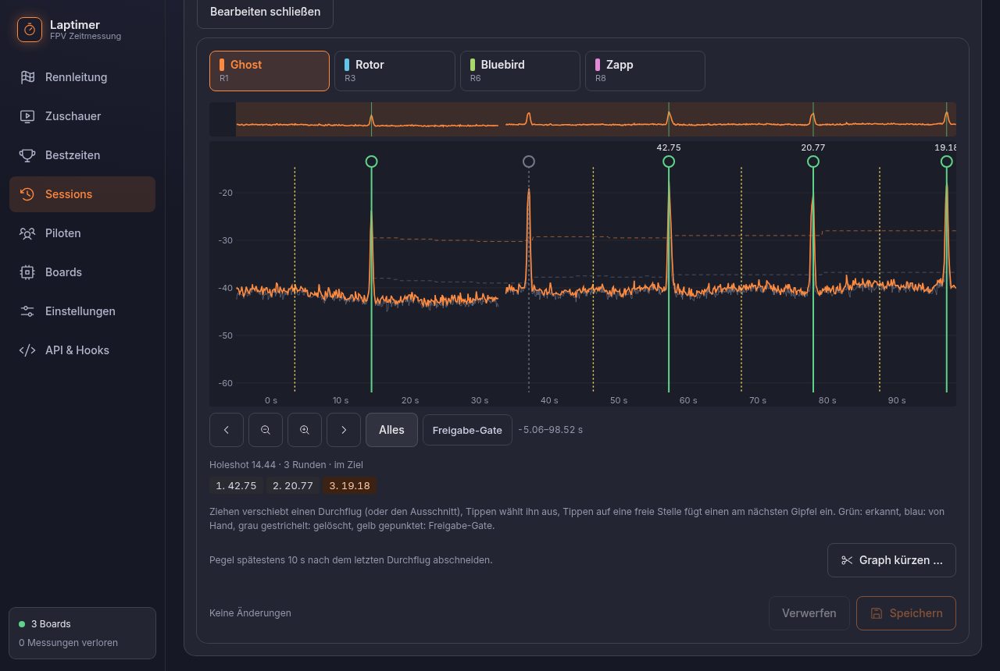
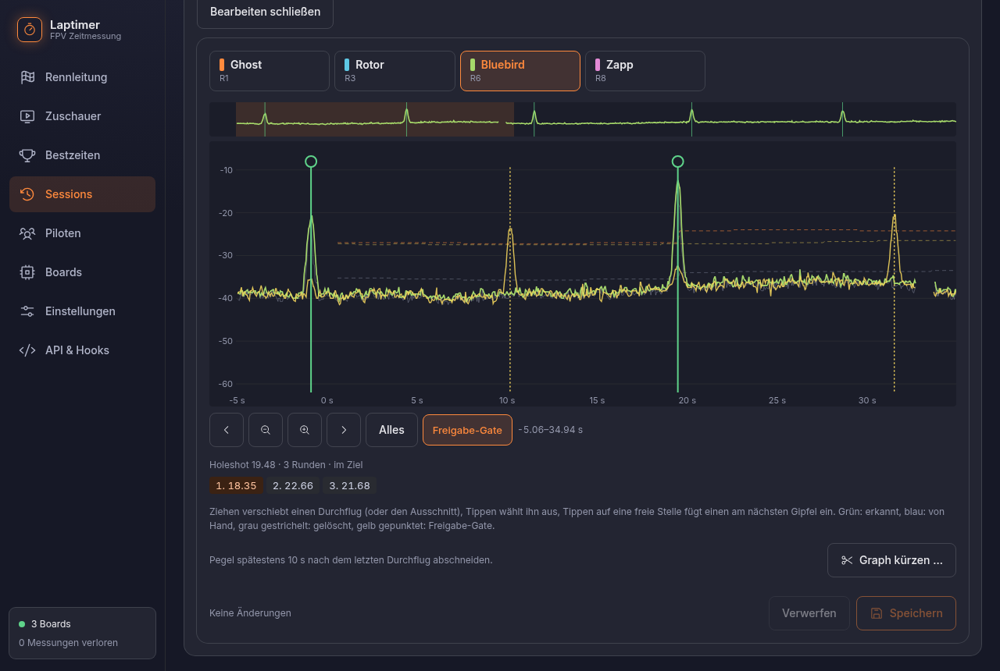

# Runden korrigieren

Ein verpasster Durchflug, ein Überflug, der mitgezählt hat: Bei anderen Systemen heißt das
oft Zettel und Stift. Hier hat jede Session ihren vollständigen Signalverlauf, und
korrigiert wird direkt im Graph, nach dem Rennen in der Rennleitung oder später unter
**Sessions → Runden bearbeiten**.

<figure markdown>
{ .shot }
<figcaption>Die ganze Session eines Piloten. Der grau gestrichelte Durchflug bei 37 s wurde
abgelehnt (das Freigabe-Gate hatte den Vorbeiflug davor verpasst), deshalb die erste Runde von
42,75 s. Antippen und „Wiederherstellen“ macht daraus zwei Runden um 20 s.</figcaption>
</figure>

## Bedienung

Oben den Kanal wählen. Darunter der Graph mit dem Pegel und den Durchflügen als senkrechte
Linien, mit Übersicht der ganzen Session und einem Ausschnitt zum Arbeiten.

| Geste | Wirkung |
|---|---|
| Durchflug **ziehen** | verschieben |
| Durchflug **antippen** | auswählen: löschen, wiederherstellen, am Gipfel einrasten |
| **freie Stelle** antippen | neuen Durchflug setzen; er rastet am nächsten Gipfel ein, die Stelle wird vorher angezeigt |
| **Fläche ziehen** | Ausschnitt verschieben |

Farben: grün erkannt, blau von Hand, grau gestrichelt gelöscht, gelb gepunktet Freigabe-Gate.

Darunter rechnet die **Runden-Vorschau** sofort mit: Rundenzeiten, Bestzeit, Platzierung. Zu
kurze Runden sind rot markiert. Erst **Speichern** schreibt die Änderungen; bis dahin bleibt
der Entwurf im Browser.

## Was dabei passiert

- Gelöschte Durchflüge sind nur markiert und lassen sich wiederherstellen; von Hand gesetzte
  werden entfernt.
- Verschobene Durchflüge gelten danach als von Hand gesetzt.
- Von Hand darf ein Durchflug auch kürzer als die Mindestrunde hinter dem vorigen liegen, nur
  nicht näher als 0,1 s.
- Weil nur Durchflüge gespeichert sind, rechnen Ergebnis, Bestzeiten und Export sofort mit
  den neuen Werten.

## Freigabe-Gate einblenden

Hatte die Session ein [Freigabe-Gate](gates.md), blendet der Schalter **Freigabe-Gate**
dessen Pegel und Schwelle gelb in denselben Graph ein. So sieht man, ob ein abgelehnter
Durchflug am Ziel wirklich keine Freigabe hatte.

{ .shot }

## Graph kürzen

Bleibt eine Session nach dem letzten Durchflug lange offen, wächst die Pegel-Datei unnötig.
**Graph kürzen** schneidet sie 10 s nach dem letzten Durchflug ab; die Schnittstelle ist vorher
rot im Graph markiert.
