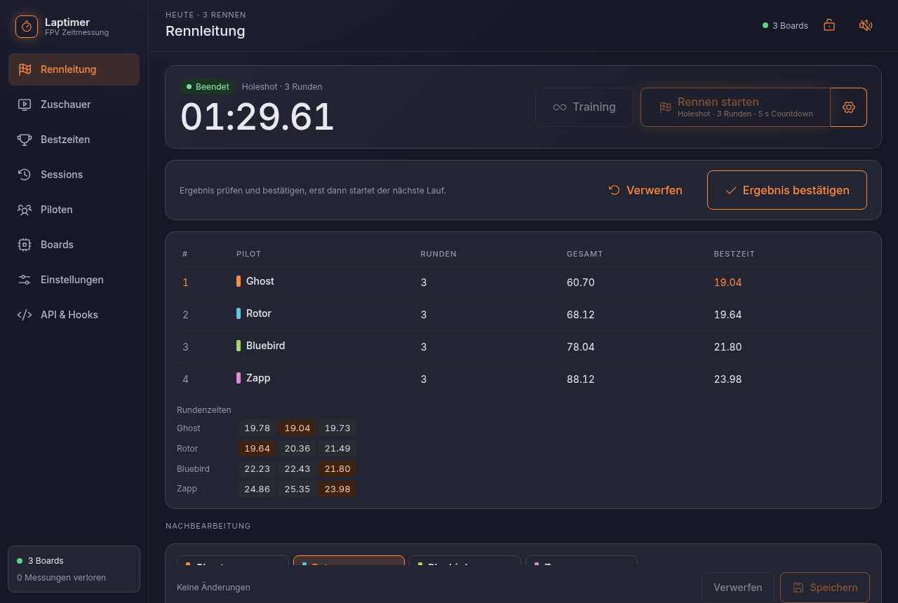
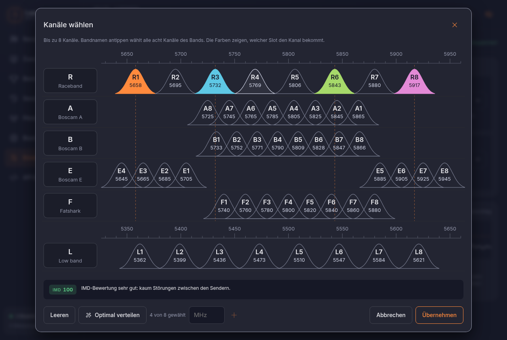
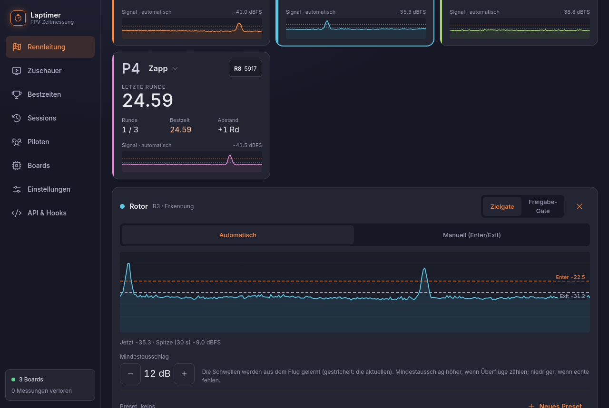
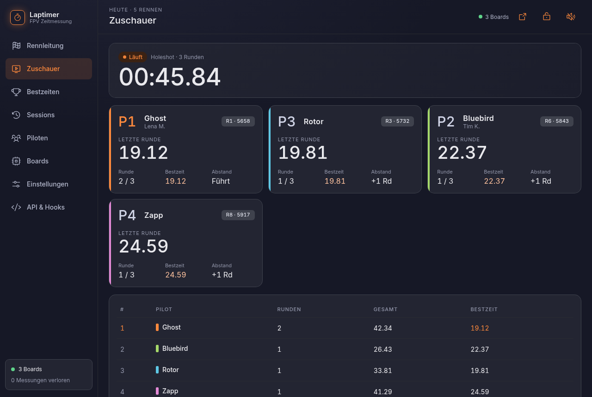

# Rennleitung

Die Seite, auf der der Abend läuft. Oben Status, Uhr und die Knöpfe **Training** und
**Rennen**; darunter eine Karte pro Slot.

{ .shot }

## Training und Rennen

**Training** läuft, bis man es stoppt. Jeder fliegt für sich, die Seite zeigt Runden und
Bestzeit, angesagt wird auf Wunsch jede neue Bestzeit.

**Rennen** haben einen Start und ein Ende, einstellbar über das Zahnrad neben dem Knopf:

| | Möglichkeiten |
|---|---|
| Start | **Holeshot** (der erste Durchflug startet die Zeit), **ab Startton**, **fliegend** |
| Ende | nach **Runden** (z. B. 3) oder nach **Zeit** |
| Countdown | aus, 3, 5 oder 10 s, mit Ansage und Startton |

Ein Rennen stoppt von selbst, wenn alle im Ziel sind. Danach erscheint das Ergebnis mit
Rangliste, darunter gleich der Editor zum [Korrigieren](korrigieren.md). Erst nach
**Ergebnis bestätigen** (oder Verwerfen) lässt sich der nächste Lauf starten. So geht kein
Ergebnis verloren, das noch jemand prüfen wollte.

{ .shot }

## Piloten und Kanäle

Name in der Karte antippen: Pilot wählen, aus der Liste oder als Gast ohne Profil. Ein Pilot,
der in einem anderen Slot sitzt, wird getauscht. **Kanal** antippen: Band und Kanal wählen, mit
Hinweis, wenn Kanäle sich stören (IMD).

Unter **Einstellungen → Messung** wählt man die Kanäle für alle Slots auf einer Übersicht aller
Bänder, mit Bewertung der Störungen und „Optimal verteilen“.

{ .shot }

## Schwellen, wenn man will

Eine Slot-Karte antippen zeigt darunter den Pegel dieses Kanals der letzten 30 Sekunden mit
den Schwellen. Standard ist **automatisch**: Die Erkennung lernt sie aus dem Flug. Auf
**Manuell** gestellt, zieht man Eintritts- und Austrittslinie direkt im Graph, wie bei
RotorHazard, oder setzt sie mit „Aus Spitze“ aus dem letzten Gipfel.

{ .shot }

Passende Werte speichert man als **Preset** für den Piloten, z. B. eines pro Drohne. Setzt man
den Piloten später in einen Slot, bekommt der Kanal sein Preset.

## Ansagen

Startsignal, Runden (Piep, Rundennummer oder Zeit), neue Bestzeit im Training, „im Ziel“ und
„Rennen vorbei“, jeweils einzeln an- oder abschaltbar. Abgespielt auf dem Pi (Lautsprecher an
der Klinke oder USB) oder in einem Browser, z. B. auf einem Laptop mit Bluetooth-Box. Namen
und Zeiten spricht eine Sprachausgabe.

## Mehr Seiten

**Zuschauer**: Karten ohne Bedienung, Rangliste, Countdown. Mit `?view=zuschauer` als Vollbild
für einen Fernseher. **Sessions**: alle Läufe mit Ergebnis, Export als CSV oder JSON.
**Bestzeiten**: heute und gesamt, beste drei in Folge, Rennen und Siege pro Pilot.

{ .shot }

!!! info "Anmelden"
    Ansehen kann jeder im WLAN: Ohne Anmeldung zeigt die Seite Zuschauer, Bestzeiten, Sessions
    und Piloten. Rennleitung, Boards, Einstellungen und API erscheinen erst nach der Anmeldung
    mit dem Passwort der Rennleitung. Ein Gerät bleibt 30 Tage angemeldet.
