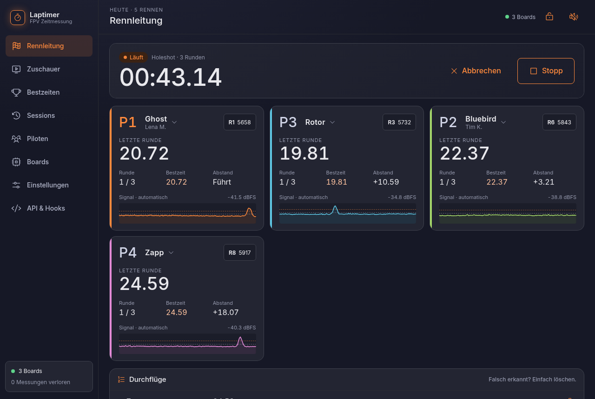
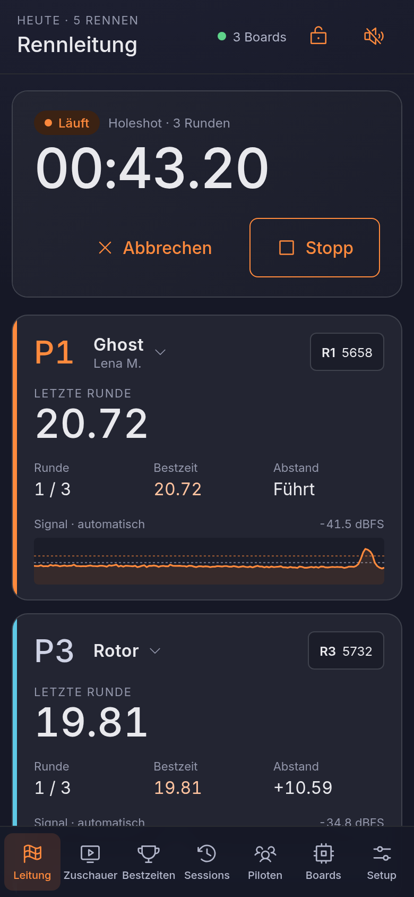
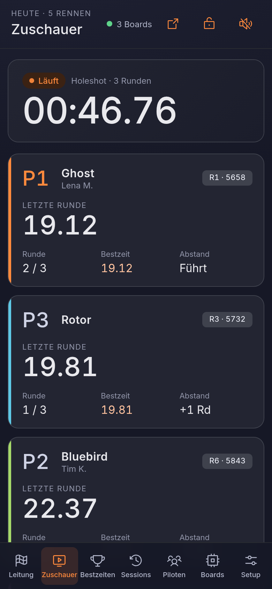

---
hide:
  - navigation
  - toc
---

<div class="hero" markdown>

# FPV Laptimer

<p class="lead">Rundenzeitmessung für FPV-Flüge im kleinen Rahmen mit Freunden: zwei, drei ESP32-C5 am Gate messen
die Videosignale, ein Raspberry Pi erkennt die Durchflüge, sagt an und zeigt alles im Browser,
am Handy wie am Laptop. Session starten, fliegen, fertig. Ohne Kalibrieren und ohne Heats
anzulegen.</p>

</div>

!!! warning "In Entwicklung"
    Der Laptimer ist noch in der Entwicklung und im Test. Vieles ist bisher nur mit
    Aufnahmen und an wenigen Abenden geprüft, nicht im regelmäßigen Einsatz. Datenformat,
    Bedienung und API können sich noch ändern. Fehler und Erfahrungen gern als
    [Issue](https://github.com/bli-blu-bla/fpv-laptimer/issues).

<figure markdown>
{ .shot }
<figcaption>Die Rennleitung während eines Rennens: pro Slot Pilot, Kanal, Runden, Bestzeit und
der Signalverlauf live.</figcaption>
</figure>

## Was er kann

<div class="grid cards" markdown>

-   :material-flag-checkered: **Rennleitung ohne Verwaltung**

    ---

    Training oder Rennen mit einem Tipp. Start per Holeshot, Startton oder fliegend; Ende nach
    Runden oder Zeit; Ansagen über den Pi oder einen Browser. Piloten und Kanäle tauscht man
    direkt in der Karte.

    [:octicons-arrow-right-24: Rennleitung](funktionen/rennleitung.md)

-   :material-chart-bell-curve: **Runden im Graph korrigieren**

    ---

    Jede Session behält den Signalverlauf. Durchflug verschieben, löschen oder neu setzen
    direkt am Gipfel, mit Runden-Vorschau, bevor gespeichert wird.

    [:octicons-arrow-right-24: Korrigieren](funktionen/korrigieren.md)

-   :material-gate: **Zwei Gates: Ziel und Freigabe**

    ---

    Ein optionales Freigabe-Gate vor dem Ziel: Eine Runde zählt nur, wenn der Pilot dort
    vorbeikam. Überflüge und Abkürzungen am Ziel fallen so raus.

    [:octicons-arrow-right-24: Zwei Gates](funktionen/gates.md)

-   :material-tune-variant: **Automatische Schwellen**

    ---

    Die Erkennung lernt Kurs- und Gipfelpegel aus dem Flug selbst. Wer will, stellt pro
    Kanal feste Schwellen ein, wie bei RotorHazard, und speichert sie als Preset pro Drohne.

    [:octicons-arrow-right-24: Erkennung](technik/erkennung.md)

-   :material-bug-outline: **Debug-Ansicht für die Boards**

    ---

    Jedes Board einzeln und kombiniert, live oder aus einer Aufnahme, mit Schwellen und
    Durchflügen nebeneinander. Aufnehmen, später neu auswerten, Debug-Paket exportieren.

    [:octicons-arrow-right-24: Boards und Debug](funktionen/boards.md)

-   :material-api: **API und Hooks**

    ---

    Alles, was die Seite kann, geht auch per HTTP oder WebSocket, mit jedem Ereignis live.
    Hooks starten eigene Scripts, z. B. eine LED beim Startsignal.

    [:octicons-arrow-right-24: API](api/index.md)

</div>

## Modern und schlicht

Eine dunkle Oberfläche mit fester Farbe pro Slot, große Zahlen, keine überladenen Menüs:
Einstellungen stehen dort, wo man sie braucht. Am Handy mit Tab-Leiste unten, am Laptop mit
Seitenleiste. Eine Zuschauer-Ansicht für Fernseher oder Tablet läuft im Vollbild ohne
Bedienung.

<div class="phones" markdown>
{ .shot }
{ .shot }
</div>

## Aufbau am Platz

```
 Ziel:  [ESP links]  [ESP rechts]         davor: [ESP Freigabe]  (optional)
              \          |                      /
               \________ USB _________________/
                          |
          Raspberry Pi (Server, Datenbank, Ansagen) ── LAN ── Router ── WLAN ── Handys
```

Die ESP32-C5 laufen mit einer veränderten Version der Firmware [widscan58](https://github.com/CapnBry/widscan58) von
Bryan Mayland ([fpv-laptimer-firmware](https://github.com/bli-blu-bla/fpv-laptimer-firmware), mit
[Flash-Seite](https://bli-blu-bla.github.io/fpv-laptimer-firmware/)) als einfacher Empfänger (SDR) für das 5,8-GHz-Band und messen jeden Kanal etwa
500-mal pro Sekunde. Mehr dazu im [Konzept](konzept.md), wem wir das verdanken unter
[Danksagung](danksagung.md).

## Installieren

Auf dem Raspberry Pi (64-bit Pi OS), einem Linux-PC oder dem Mac:

```sh
curl -fsSL https://github.com/bli-blu-bla/fpv-laptimer/releases/latest/download/install.sh | bash
```

Derselbe Befehl aktualisiert später. Danach `http://<rechner>.local:5800` öffnen.
Alles Weitere: [Installation](INSTALL.md) · [FAQ](faq.md) · [API](api/index.md) · [Technik](technik/index.md)
