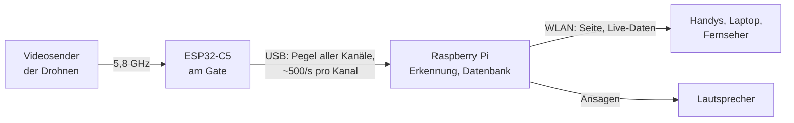

# Konzept

## Warum noch ein Laptimer?

[RotorHazard](https://github.com/RotorHazard/RotorHazard) ist der Standard für FPV-Rennen
und kann sehr viel: Heats, Klassen, Formate, Event-Verwaltung. Für einen Stammtisch, an dem
abends vier Leute ein paar Runden drehen, ist das oft zu viel Verwaltung, und die Empfänger
wollen kalibriert werden.

Der FPV Laptimer setzt deshalb andere Schwerpunkte:

- **Starten statt verwalten:** Sessions starten, stoppen, gespeichert wird von selbst. Kein
  Event, keine Heats, keine Klassen.
- **Möglichst ohne Kalibrierung:** Die Schwellen lernt die Erkennung aus dem Flug.
- **Fehler nachträglich korrigieren:** Jede Session behält den Signalverlauf; ein
  verpasster oder doppelter Durchflug ist mit zwei Tipps im Graph behoben.
- **Günstige, einfache Hardware:** ESP32-C5-Boards statt RX5808-Module, per USB am Pi.

## Wie gemessen wird

Ein FPV-Videosender strahlt auf einem festen Kanal im 5,8-GHz-Band. Je näher die Drohne am
Empfänger, desto stärker das Signal. Fliegt sie durchs Gate, steigt der Pegel an den Boards
für einen Moment deutlich an. Die Mitte dieses Buckels ist der Durchflug.

Die ESP32-C5 können eigentlich WLAN im 5-GHz-Band. Die Firmware
[widscan58](https://github.com/CapnBry/widscan58) von Bryan Mayland nutzt den Funkteil als
einfachen Software-Empfänger: Sie springt reihum über die eingestellten Kanäle (z. B. R1, R3,
R6, R8) und misst jeweils den Pegel. Bei vier Kanälen kommt pro Kanal alle 2 ms ein Wert.

## Mehrere Boards an einem Gate

Ein einzelnes Board sieht die Drohne nicht immer gut: Antenne verdeckt, Drohne schräg,
Sendepause. Deshalb sitzen meist zwei Boards an den unteren Ecken des Gates, und der Server
nimmt pro Zeitpunkt den höheren Pegel (Diversity). In den Testaufnahmen haben einzelne Boards
Durchflüge verpasst oder erfunden; kombiniert stimmten alle.

Ein drittes Board kann an anderer Stelle der Strecke als **Freigabe-Gate** stehen: Eine
Runde zählt dann nur, wenn der Pilot dazwischen dort vorbeikam. Siehe
[Zwei Gates](funktionen/gates.md).

## Was gespeichert wird

Der Server speichert **Durchflüge**, nicht Runden. Runden, Bestzeit, beste drei in Folge und
die Rangliste werden aus den Durchflügen jedes Mal neu berechnet. Deshalb wirkt jede
Korrektur sofort überall: im Ergebnis, in den Bestzeiten, im Export.

Dazu kommt pro Session eine Datei mit allen Rohpegeln. Aus ihr zeichnet die Seite den
Signalverlauf für die Korrektur, und mit ihr lässt sich die Erkennung später neu laufen lassen,
etwa mit anderen Einstellungen.

## Genauigkeit

Ehrlich gesagt: Der Gipfel beim Durchflug ist ein breiter Buckel, keine scharfe Spitze. Für
denselben Durchflug lagen zwei Boards in den Tests bis zu 0,3 bis 0,4 s auseinander.
Für Rundenzeiten am Stammtisch und ein faires Rennen reicht das; für Wettkämpfe mit
Hundertstel-Entscheidungen ist ein System mit Transpondern die bessere Wahl. Mit fest
montierten Boards und Richtantennen soll das noch genauer gemessen werden.
