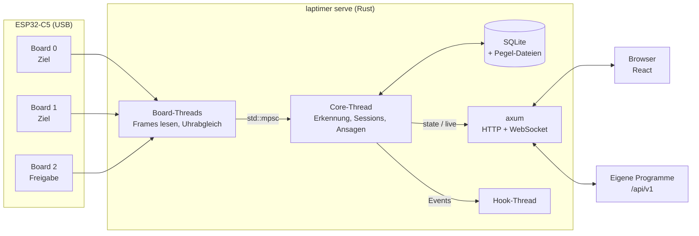
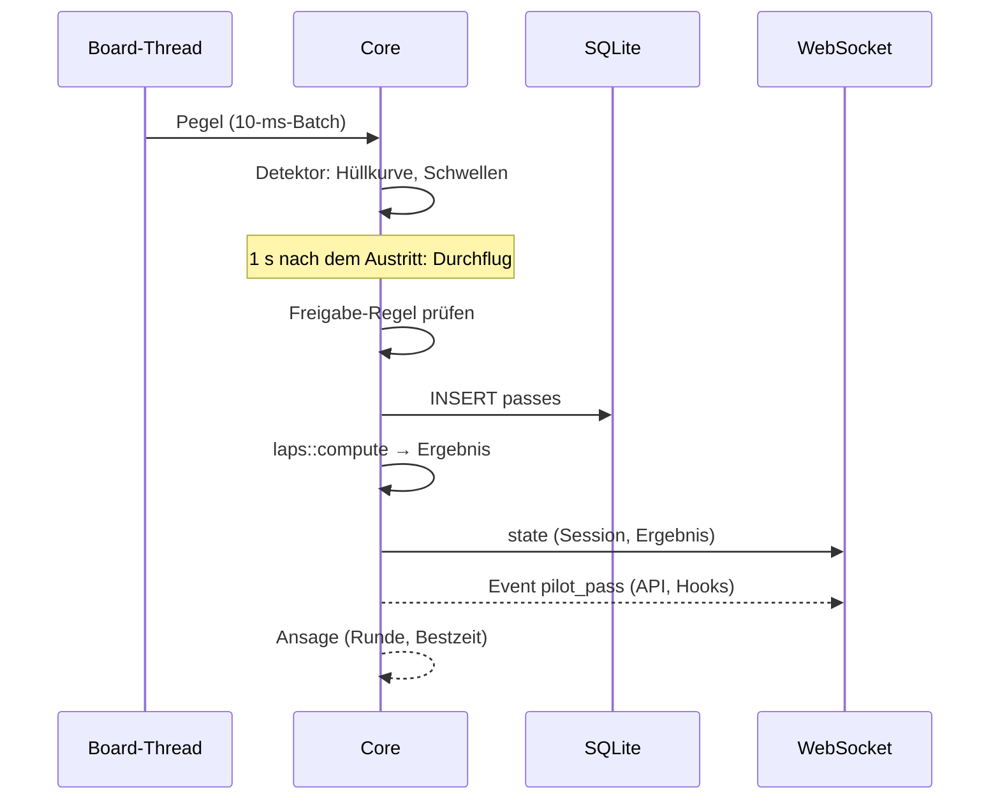

# Architektur

## Überblick



Der Server ist ein einzelnes Programm in Rust, ohne Laufzeit-Abhängigkeiten außer `mpg123`
und einer Sprachausgabe für die Ansagen. SQLite ist einkompiliert, die Weboberfläche liegt als
fertige Dateien daneben.

## Threads

Der Kern läuft bewusst mit normalen Threads und `std::sync::mpsc` statt async, weil das
einfacher zu lesen ist. Nur der Webserver (axum) läuft auf tokio.

| Thread | Aufgabe |
|---|---|
| ein Thread pro Board | liest den USB-Strom, zerlegt ihn in Frames, rechnet Board-Zeit in Host-Zeit um, schickt die Pegel per Kanal an den Core |
| Core | nimmt Pegel entgegen (`on_board_event`), füttert die Detektoren, und alle 10 ms `tick`: Countdown, Startsignal, neue Durchflüge in die Datenbank, Ergebnisse, Live-Nachricht (10 Hz) |
| tokio (axum) | Seite, REST, WebSockets; Anfragen, die die Datenbank oder Dateien brauchen, gehen in `spawn_blocking` |
| Ansagen | spielt eine Liste von Clips und Sprachausgaben nacheinander ab |
| Hooks | startet die Scripts nacheinander, mit 10 s Zeitlimit |

Der `Core` liegt in einem `std::sync::Mutex`. Die Regel: diese Sperre nie über ein `.await`
halten, sonst blockiert sie einen tokio-Thread.

## Zeit

Alle Zeiten in der Datenbank sind **Wanduhr-Mikrosekunden**: `origin_unix_us + host_us`, also
der Zeitpunkt des Serverstarts plus die monotone Uhr seither. Start, Ende, Durchflüge und
`tick` nehmen alle diese eine Uhr, nicht die Systemuhr.

Der Grund: Ein Raspberry Pi hat keine Akku-Uhr. Er bootet mit einer alten Zeit, und erst NTP
stellt sie später, wenn überhaupt. In einer echten Session sprang die Uhr so um 27 Stunden,
und alle Durchflüge lagen plötzlich vor dem Start. Jetzt folgt der Server einem Sprung der
Systemuhr nur beim Start einer Session, nie während einer.

Die Boards haben jeweils ihre eigene Uhr. Der Server gleicht sie über `TIME?` ab, siehe
[Firmware und Protokoll](firmware.md#uhrabgleich).

## Speicher

```
~/.laptimer/data/
  laptimer.db                 SQLite
  levels/session_<id>.csv     Rohpegel jeder Session
  recordings/                 Aufnahmen aus der Debug-Ansicht
  backups/                    gepackte Kopien der Datenbank
  hooks/                      Scripts für Hooks
  tts/                        Sprachausgabe-Cache
```

| Tabelle | Inhalt |
|---|---|
| `sessions` | Training oder Rennen, mit der Konfiguration als JSON (Start, Ende, Erkennung), damit alte Ergebnisse gleich bleiben, wenn sich Einstellungen ändern; `confirmed_us` |
| `seats` | wer in der Session auf welchem Kanal flog |
| `passes` | Durchflüge: Zeit, Kanal, `gate` (0 Ziel, 1 Freigabe), `manual`, `deleted` |
| `pilots`, `presets` | Piloten und ihre Schwellen-Presets |
| `settings` | alle Einstellungen der Seite als JSON |
| `api_keys`, `logins`, `hooks` | Zugänge (nur sha256 gespeichert) und Hooks |

**Runden werden nie gespeichert.** `laps::compute` rechnet sie bei jedem Abruf aus den
Durchflügen: Startregel (Holeshot, ab Start, fliegend), Ende (Runden, Zeit, offen),
Mindestrunde, ignorierte Durchflüge. Diese Funktion ist rein und getestet; eine JavaScript-Kopie
im Frontend rechnet die Vorschau im Editor.

Session-IDs werden nie wiederverwendet (SQLite würde nach dem Löschen die höchste wieder
vergeben). Entwürfe im Browser und exportierte Dateien hängen an der ID.

## Vom Durchflug zur Anzeige



Die Seite bekommt über `/ws` zuerst den ganzen Zustand (`state`), danach `state` bei
Änderungen und `live` zehnmal pro Sekunde (Pegel, Freigabe-Status, Boards). Die öffentliche
API hat ihren eigenen WebSocket mit Events, siehe [API-Referenz](../API.md).

## Installation und Updates

```
~/.laptimer/
  config.toml           Host, Port, Passwort, Update-Quelle
  current  -> releases/0.2.0
  previous -> releases/0.1.3
  releases/<ver>/       bin/laptimer, web/, sounds/, …
```

`install.sh` lädt das Paket für System und Prozessor, prüft die sha256 und richtet unter Linux
per sudo ein, was fehlt. Den Rest macht `laptimer install` aus dem entpackten Paket: kopieren,
`current`/`previous` umsetzen (neuer Symlink, dann `rename`, also atomar), Config beim ersten
Mal, optional der Dienst (systemd-User-Unit oder launchd-Agent).

Ein **Update über die Seite** hat zwei Schritte: Bereitstellen (Upload oder Download von
GitHub, Signatur mit minisign gegen den eingebauten öffentlichen Schlüssel prüfen, entpacken,
Prozessor des Programms prüfen) und Installieren (Backup, `current` umsetzen, beenden).
Mit Dienst startet systemd bzw. launchd die neue Version; ohne Dienst ersetzt sich der Server
per `exec` selbst.

Kommt die neue Version nicht hoch, greift ein kleines Shell-Script vor jedem Start des Dienstes
(`update-check.sh`): Der Server schreibt vor dem Umschalten `update-pending`, die neue
Version löscht es nach 15 s Laufzeit. Zählt das Script vier Starts ohne Bestätigung, schaltet es
zurück und hinterlässt `update-failed`, das die Seite anzeigt.
