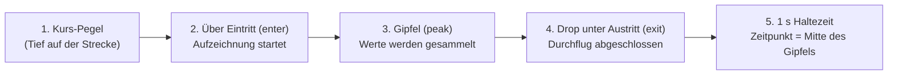

# Automatik-Modus im Detail: Anstieg, Drop und Zeitpunkt

Im automatischen Modus (`DetectMode::Auto` in `server/src/detect.rs`) stellt man keine festen
dBFS-Schwellen ein. Stattdessen beobachtet der Detektor laufend den Pegelverlauf jedes Kanals und
erkennt Durchflüge anhand des **Unterschieds zwischen Streckenpegel (Tief) und Gate-Gipfel (Hoch)**.

Dabei gilt ein wichtiges Prinzip:

- **Abgeschlossen** wird ein Durchflug erst beim **Drop**, also wenn das Signal vom Hoch wieder
  unter die Austrittsschwelle fällt (gemeldet wird er noch 1 s später).
- **Als Zeitpunkt** zählt aber nicht der Drop, sondern rückblickend die **Mitte des Gipfels**.

## 1. Warum erst beim Drop erkannt wird

Während eine Drohne auf das Gate zufliegt und der Pegel steigt, kann der Detektor im Live-Betrieb
noch nicht wissen, ob der aktuelle Messwert schon der höchste Punkt ist oder ob der Pilot dem Gate
noch näher kommt.



Darum läuft jeder Durchflug in fünf Phasen ab (`server/src/detect.rs`):

1. **Auf der Strecke (Tief):** Solange der Pegel unter der Eintrittsschwelle liegt, passiert nichts;
   der Detektor führt nur die Pegelstatistik der letzten 3 Minuten mit.
2. **Anstieg über `enter`:** Überschreitet die Hüllkurve die Eintrittsschwelle, beginnt ein
   möglicher Durchflug. Ab jetzt speichert der Detektor jeden 10-ms-Slot (`(time_us, level)`)
   in einer Liste (`crossing`).
3. **Im Gate (Hoch):** Solange das Signal über der Austrittsschwelle (`exit`) bleibt, sammelt der
   Detektor weiter alle Werte – auch wenn der Pegel schon am höchsten Punkt vorbei ist.
4. **Drop unter `exit` (`end_crossing`):** Erst in dem Moment, in dem der Pegel vom Hoch wieder
   unter `exit` fällt, weiß der Detektor sicher, dass die Drohne das Gate verlassen hat. Jetzt
   wird der gesammelte Verlauf ausgewertet.
5. **1 s Haltezeit (`HOLD_US`):** Nach dem Drop unter `exit` wartet der Detektor noch 1 Sekunde,
   bevor er den Durchflug endgültig meldet. Fällt das Signal mitten im Gate kurz ab (etwa durch
   eine Antennen-Nullstelle) und steigt wieder, entsteht ein zweiter Abschnitt. Liegen beide
   näher als die Mindestrunde (Standard 3 s) beieinander, bleibt **einer** übrig: der mit dem
   höheren Gipfel, samt seiner Zeit; der andere wird verworfen. Die Haltezeit sorgt dafür, dass
   der zweite Abschnitt noch vor der Meldung kommt.

Bevor ein Kanal überhaupt gelernte Schwellen hat (nach 5 s Sender über −46 dBFS), wird nichts
erkannt; die letzten 10 s werden dann nachträglich ausgewertet. Wie frühe Fehltreffer im Anlauf
zurückgenommen werden, steht unter [Durchflug-Erkennung](erkennung.md#schritte-pro-kanal)
(Schritt 7).

## 2. Welche Differenz zählt?

Der Automatik-Modus bewertet immer die **Spanne zwischen dem normalen Kurs-Pegel und dem
Gipfelpegel**:

| Größe | Bedeutung im Code (`detect.rs`) |
|---|---|
| **Kurs (`course`)** | Median der Hüllkurve während der letzten 3 Minuten, solange der Sender an ist (> −46 dBFS). Das ist das typische „Tief“ unterwegs auf der Strecke. |
| **Gipfel (`peak`)** | Median der letzten 5 Durchflug-Maxima dieses Kanals (vor dem 3. Durchflug geschätzt über das 99,5-%-Perzentil). |
| **Differenz (`peak − course`)** | Der gelernte Gesamtausschlag zwischen Strecke und Gate (muss mindestens 3 dB betragen, sonst gibt es noch keine Schwellen). |
| **Mindestausschlag (`min_rise_db`)** | Untergrenze für den Anstieg über den Kurs-Pegel (Standard: **12 dB**, pro Kanal einstellbar). |

Aus dieser Differenz berechnet `update_thresholds()` einmal pro Sekunde zwei Schwellen:

```text
enter = max(course + 60 % × (peak − course),  course + min_rise_db)
exit  = min(course + 20 % × (peak − course),  enter − 1 dB)
```

### Was das praktisch bedeutet

Damit ein Durchflug erkannt wird, müssen **beide** Bedingungen nacheinander erfüllt sein:

1. **Ausreichender Anstieg (Tief → Hoch):** Der Pegel muss `enter` erreichen. `enter` ist der
   größere von zwei Werten: 60 % der Spanne `Gipfel − Kurs` über dem Kurs, oder der
   Mindestausschlag (12 dB) über dem Kurs.
2. **Ausreichender Drop (Hoch → Tief):** Danach muss der Pegel wieder unter `exit` fallen, also
   auf höchstens 20 % der Spanne über dem Kurs. Vom gelernten Gipfel aus sind das mindestens
   **80 %** des Ausschlags.

### Rechenbeispiel

- **Kurs-Pegel (`course`):** −38 dBFS
- **Gelernte Gipfel (`peak`):** −18 dBFS
- **Differenz (`peak − course`):** 20 dB
- **Eintritt (`enter`):** `−38 + 0,6 × 20 = −26 dBFS` (liegt 12 dB über Kurs, erfüllt
  also auch `min_rise_db = 12 dB`)
- **Austritt (`exit`):** `−38 + 0,2 × 20 = −34 dBFS`

Verlauf beim Durchflug:

- Steigt der Pegel von −38 dBFS über **−26 dBFS**, startet die Messung des Durchflugs.
- Erreicht er im Gate **−18 dBFS**, wird dieser Spitzenwert im Puffer mitgeschnitten.
- Erst wenn der Pegel beim Wegfliegen um **16 dB** (80 % von 20 dB, von −18 dBFS bis unter
  **−34 dBFS**) gefallen ist, wird der Durchflug abgeschlossen.

## 3. Welcher Zeitpunkt für die Rundenzeit zählt

Obwohl der Durchflug erst beim Drop unter `exit` fertig erkannt (und noch 1 s gehalten) wird,
verschiebt das den Zeitpunkt **nicht**:

1. Beim Drop unter `exit` durchsucht `end_crossing()` alle während des Durchflugs gesammelten
   10-ms-Slots nach dem absoluten Maximum `peak`.
2. Anschließend filtert der Detektor alle Slots heraus, die höchstens **1 dB (`TOP_CODES = 4`)**
   unter diesem Maximum liegen.
3. Der gemeldete Durchflug-Zeitpunkt `time_us` ist exakt der **Mittelwert aus dem ersten und dem
   letzten Slot dieser 1-dB-Kuppe**:

```rust
let peak = crossing.iter().map(|(_, l)| *l).max().unwrap();
let top: Vec<i64> = crossing
    .iter()
    .filter(|(_, l)| *l + TOP_CODES >= peak)
    .map(|(t, _)| *t)
    .collect();
let time_us = (top[0] + top[top.len() - 1]) / 2;
```

Zusätzlich zieht der Detektor die feste Fenster-Verzögerung der Hüllkurve (`ENVELOPE_DELAY_US = 45 ms`)
bereits beim Berechnen der Slot-Zeit ab. Der Drop bestimmt also nur, **wann** der Gipfel
ausgewertet wird, nicht die Zeit des Durchflugs.

Genauer als der Gipfel selbst wird die Zeit dadurch nicht: Er ist ein breiter Buckel, und für
denselben Durchflug liegen verschiedene Boards bis 0,3–0,4 s auseinander. Die Mitte der
1-dB-Kuppe ist dabei stabiler als der höchste Einzelwert.
