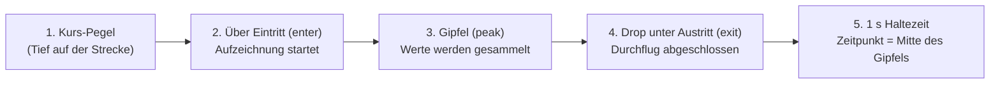

# Automatik-Modus im Detail: Anstieg, Drop und Zeitpunkt

Im automatischen Modus (`DetectMode::Auto` in `server/src/detect.rs`) stellt man keine festen
dBFS-Schwellen ein. Stattdessen beobachtet der Detektor laufend den Pegelverlauf jedes Kanals und
erkennt Durchflüge anhand des **Unterschieds zwischen Streckenpegel (Tief) und Gate-Gipfel (Hoch)**.

Dabei gilt ein wichtiges Prinzip:

- **Abgeschlossen** wird ein Durchflug erst beim **Drop**, also wenn das Signal vom Hoch wieder
  unter die Austrittsschwelle fällt (gemeldet wird er noch 1 s später).
- **Als Zeitpunkt** zählt aber nicht der Drop, sondern rückblickend die **Mitte des Gipfels**.

## 1. Warum erst beim Drop erkannt wird

Während eine Drohne auf das Gate zufliegt und der Pegel steigt, kann der Detektor im Live-Betrieb
noch nicht wissen, ob der aktuelle Messwert schon der höchste Punkt ist oder ob der Pilot dem Gate
noch näher kommt.



Darum läuft jeder Durchflug in fünf Phasen ab (`server/src/detect.rs`):

1. **Auf der Strecke (Tief):** Solange der Pegel unter der Eintrittsschwelle liegt, passiert nichts;
   der Detektor führt nur die Pegelstatistik der letzten 3 Minuten mit.
2. **Anstieg über `enter`:** Überschreitet die Hüllkurve die Eintrittsschwelle, beginnt ein
   möglicher Durchflug. Ab jetzt speichert der Detektor jeden 10-ms-Slot (`(time_us, level)`)
   in einer Liste (`crossing`).
3. **Im Gate (Hoch):** Solange das Signal über der Austrittsschwelle (`exit`) bleibt, sammelt der
   Detektor weiter alle Werte – auch wenn der Pegel schon am höchsten Punkt vorbei ist.
4. **Drop unter `exit` (`end_crossing`):** Erst in dem Moment, in dem der Pegel vom Hoch wieder
   unter `exit` fällt, weiß der Detektor sicher, dass die Drohne das Gate verlassen hat. Jetzt
   wird der gesammelte Verlauf ausgewertet.
5. **1 s Haltezeit (`HOLD_US`):** Nach dem Drop unter `exit` wartet der Detektor noch 1 Sekunde,
   bevor er den Durchflug endgültig meldet. Fällt das Signal mitten im Gate kurz ab (etwa durch
   eine Antennen-Nullstelle) und steigt wieder, entsteht ein zweiter Abschnitt. Kommt er noch
   in der Haltezeit, bleibt **einer** übrig: der mit dem höheren Gipfel, samt seiner Zeit.
   Kommt er danach, aber näher als die Mindestrunde (Standard 3 s), ist der erste schon
   gemeldet und der zweite wird verworfen, außer am Zielgate: Ist er höchstens 2 s später
   und mindestens 6 dB stärker, ersetzt er den gemeldeten (der war ein Buckel vor dem Gate,
   siehe [Durchflug-Erkennung](erkennung.md#schritte-pro-kanal), Schritt 6).

Bevor ein Kanal überhaupt gelernte Schwellen hat (nach 5 s Sender über −46 dBFS), wird nichts
erkannt; die letzten 10 s werden dann nachträglich ausgewertet. Wie frühe Fehltreffer im Anlauf
zurückgenommen werden, steht unter [Durchflug-Erkennung](erkennung.md#schritte-pro-kanal)
(Schritt 7).

## 2. Welche Differenz zählt?

Der Automatik-Modus bewertet immer die **Spanne zwischen dem normalen Kurs-Pegel und dem
Gipfelpegel**:

| Größe | Bedeutung im Code (`detect.rs`) |
|---|---|
| **Kurs (`course`)** | Median der Hüllkurve während der letzten 3 Minuten, solange der Sender an ist (> −46 dBFS). Das ist das typische „Tief“ unterwegs auf der Strecke. |
| **Gipfel (`peak`)** | Median der letzten 5 Durchflug-Maxima dieses Kanals (vor dem 3. Durchflug geschätzt über das 99,5-%-Perzentil). |
| **Differenz (`peak − course`)** | Der gelernte Gesamtausschlag zwischen Strecke und Gate (muss mindestens 3 dB betragen, sonst gibt es noch keine Schwellen). |
| **Mindestausschlag (`min_rise_db`)** | Untergrenze für den Anstieg über den Kurs-Pegel (Standard: **12 dB**, pro Kanal einstellbar). |

Aus dieser Differenz berechnet `update_thresholds()` einmal pro Sekunde zwei Schwellen:

```text
enter = max(course + 60 % × (peak − course),  course + min_rise_db)
exit  = min(course + 20 % × (peak − course),  enter − 1 dB)
```

### Was das praktisch bedeutet

Damit ein Durchflug erkannt wird, müssen **beide** Bedingungen nacheinander erfüllt sein:

1. **Ausreichender Anstieg (Tief → Hoch):** Der Pegel muss `enter` erreichen. `enter` ist der
   größere von zwei Werten: 60 % der Spanne `Gipfel − Kurs` über dem Kurs, oder der
   Mindestausschlag (12 dB) über dem Kurs.
2. **Ausreichender Drop (Hoch → Tief):** Danach muss der Pegel wieder unter `exit` fallen, also
   auf höchstens 20 % der Spanne über dem Kurs. Vom gelernten Gipfel aus sind das mindestens
   **80 %** des Ausschlags.

### Rechenbeispiel

- **Kurs-Pegel (`course`):** −38 dBFS
- **Gelernte Gipfel (`peak`):** −18 dBFS
- **Differenz (`peak − course`):** 20 dB
- **Eintritt (`enter`):** `−38 + 0,6 × 20 = −26 dBFS` (liegt 12 dB über Kurs, erfüllt
  also auch `min_rise_db = 12 dB`)
- **Austritt (`exit`):** `−38 + 0,2 × 20 = −34 dBFS`

Verlauf beim Durchflug:

- Steigt der Pegel von −38 dBFS über **−26 dBFS**, startet die Messung des Durchflugs.
- Erreicht er im Gate **−18 dBFS**, wird dieser Spitzenwert im Puffer mitgeschnitten.
- Erst wenn der Pegel beim Wegfliegen um **16 dB** (80 % von 20 dB, von −18 dBFS bis unter
  **−34 dBFS**) gefallen ist, wird der Durchflug abgeschlossen.

## 3. Welcher Zeitpunkt für die Rundenzeit zählt

Obwohl der Durchflug erst beim Drop unter `exit` fertig erkannt (und noch 1 s gehalten) wird,
verschiebt das den Zeitpunkt **nicht**:

1. Beim Drop unter `exit` durchsucht `end_crossing()` alle während des Durchflugs gesammelten
   10-ms-Slots nach dem absoluten Maximum `peak`.
2. Anschließend filtert der Detektor alle Slots heraus, die höchstens **1 dB (`TOP_CODES = 4`)**
   unter diesem Maximum liegen.
3. Der gemeldete Durchflug-Zeitpunkt `time_us` ist exakt der **Mittelwert aus dem ersten und dem
   letzten Slot dieser 1-dB-Kuppe**:

```rust
let peak = crossing.iter().map(|(_, l)| *l).max().unwrap();
let top: Vec<i64> = crossing
    .iter()
    .filter(|(_, l)| *l + TOP_CODES >= peak)
    .map(|(t, _)| *t)
    .collect();
let time_us = (top[0] + top[top.len() - 1]) / 2;
```

Zusätzlich zieht der Detektor die feste Fenster-Verzögerung der Hüllkurve (`ENVELOPE_DELAY_US = 45 ms`)
bereits beim Berechnen der Slot-Zeit ab. Der Drop bestimmt also nur, **wann** der Gipfel
ausgewertet wird, nicht die Zeit des Durchflugs.

Genauer als der Gipfel selbst wird die Zeit dadurch nicht: Er ist ein breiter Buckel, und für
denselben Durchflug liegen verschiedene Boards bis 0,3–0,4 s auseinander. Die Mitte der
1-dB-Kuppe ist dabei stabiler als der höchste Einzelwert.

## 4. Experimentell: jedes Board an seinem eigenen Streckenpegel

Neben „Automatisch“ gibt es den Modus **„Automatisch (experimentell)“** (`DetectMode::AutoRelative`,
in den Einstellungen `"auto_relative"`). Er ist pro Kanal und Gate wählbar wie die anderen:
Rennleitung → Slot antippen, oder Boards → Einrichtung → „Alle automatisch (experimentell)“.
„Automatisch“ selbst bleibt unverändert.

### Das Problem

Normalerweise zählt von den Boards eines Gates in jedem Moment das lauteste (Maximum der
Hüllkurven), und auf dieser einen Linie werden Kurs und Gipfel gelernt. Hört ein Board die
ganze Strecke laut, stellt es den Kurs für das Gate, und die sauberen Buckel eines leiseren
Boards bleiben unter der Schwelle.

Session 57 (2026-11-13, R2, zwei Ziel-Boards): Board 1 hörte die Strecke mit −35 dBFS, seine
Buckel am Gate stiegen nur 7–10 dB. Board 2 lag bei −43,5 dBFS mit Buckeln von 14–15,5 dB, die
aber nur bis −26 … −28 dBFS reichten. Eintritt lag bei etwa −23 dBFS: live wurden 2 Durchflüge
gespeichert, die Neuberechnung findet 4, geflogen wurden etwa 10.

### Was der Modus anders macht

Nur Schritt 3 (Boards kombinieren) ist anders, alles danach ist dieselbe Zustandsmaschine:

1. Jedes Board lernt pro Kanal seinen **eigenen Kurs**, genau wie oben: Median seiner Hüllkurve
   der letzten 3 Minuten über −46 dBFS, nach 5 s solcher Pegel.
2. Das Board mit dem höchsten Kurs ist die **Referenz**. Jedes andere Board wird um
   `Kurs der Referenz − eigener Kurs` angehoben, sodass alle Streckenpegel übereinander liegen.
3. Von diesen verschobenen Hüllkurven zählt das Maximum. Darauf laufen Kurs, Gipfel, Eintritt
   (60 %, mindestens der Mindestausschlag), Austritt, Haltezeit, Mindestrunde, Zurücknehmen und
   der Rückblick der ersten 10 s wie gehabt.

Anders gesagt: verglichen wird der **Anstieg über dem eigenen Streckenpegel**, nicht der
absolute Pegel. Boards, die ihren Kurs noch nicht gelernt haben oder gerade unter −46 dBFS
liegen (für sie ist der Sender aus), bleiben außen vor. Solange noch kein Board einen Kurs hat,
gilt das gewöhnliche Maximum. Mit nur einem Board am Gate ist der Modus exakt „Automatisch“.

### Was Graph und Zahlen zeigen

Pegel, Schwellen und Gipfel bleiben in dBFS, und zwar **„so, wie das Referenz-Board es gesehen
hätte“**: Anstieg über dem eigenen Kurs plus Kurs des lautesten Boards. Diese Darstellung wurde
gewählt, weil so alles Übrige (Achsen, Schwellenlinien, Presets, Debug-Seite) unverändert
weiterarbeitet, die Zahlen nahe an denen des normalen Modus bleiben (ein Umschalten während
der Session verschiebt die gelernte Statistik kaum) und das zuerst angelernte Board meist auch
das lauteste ist, die Referenz also nicht springt. Die Folgen:

- **Gesamt** (Editor, Erkennungs-Panel, Debug-Seite): die kombinierte Linie der verschobenen
  Boards mit den dazu passenden Schwellen. Der Gipfel eines Durchflugs kann dort höher liegen
  als alles, was ein Board gemessen hat (Session 57: Board 2 misst −27,5 dBFS, angehoben um
  6,25 dB ergibt −21,25 dBFS).
- **Ein Board allein** (S1 / S2 …): sein gemessener Pegel; die Schwellen werden um die
  Verschiebung dieses Boards zurückgerechnet und passen damit zu seiner Linie. Der Graph
  liefert dafür `board_shift`, die `live`-Nachricht `finish_shifts` / `arming_shifts`, das
  Debug-Paket die Spalten `board<n>_shift_db`.

### Gegenprüfung (2026-11-13)

Alt („Automatisch“) gegen neu, beide mit dem echten Detektor (`laptimer replay --mode
auto|auto_relative --detail`), Mindestausschlag 12 dB, Mindestrunde 3 s, auf 21 Pegel-Dateien:
den Debug-Paketen der Sessions 57 und 64, einer Aufnahme vom 2026-10-29 und den Sessions 14–36
(2026-10-30 bis 2026-11-03; 28–35 sind Wiedergaben). „Automatisch“ liefert auf allen 21 Dateien
Zeile für Zeile dasselbe wie vor der Änderung.

| Daten | Automatisch | experimentell | Unterschied |
|---|---|---|---|
| Session 57, R2 (das Problem) | 4 | 9 | +5, alle im Rundenrhythmus (35–43 s), Board 2 je +14 … +15,5 dB |
| Session 64, R2 (nach Sensortausch) | 3 | 3 | gleich, Zeiten bis 0,15 s anders |
| Aufnahme 2026-10-29, R3 | 7 | 7 | gleich |
| Sessions 14–36, Zielgate, alle Kanäle | 303 | 309 | +8, −2, 5 an anderer Stelle |
| Sessions 14–35, Freigabe-Gate | 316 | 318 | +14, −12, 3 an anderer Stelle |

Zum Zielgate der Sessions 14–36 im Einzelnen (als unabhängiger Anhaltspunkt dient das
Freigabe-Gate: lag 3 s vor bis 1 s nach dem Durchflug ein Freigabe-Durchflug?):

- **+8 neu:** 4 mit Freigabe (Session 17: R1 bei +25/+29 dB und +15/+17 dB, R8 +13/+11 dB;
  Session 14: R4 +10,5 dB auf nur einem Board, fraglich), 4 ohne. Einer davon ist sehr
  wahrscheinlich falsch: Session 21, R6 (und dieselbe Stelle in der Wiedergabe Session 30). Dort
  stand ein Sender vor dem Start, ein Board hörte ihn konstant mit −24 dBFS, das andere mit
  −36 dBFS, und eine kurze Spitze von +20 dB auf dem leisen Board zählt im neuen Modus. Im
  alten deckte das laute Board sie zu.
- **−2 weg:** beide ohne Freigabe und 5–6 s nach einem anderen Durchflug, vermutlich
  Fehltreffer.
- **5 an anderer Stelle** (1,2–1,6 s): In 4 Fällen meldet der alte Modus einen Vorbuckel
  (+12 dB auf einem Board) und verwirft den eigentlichen Durchflug 1,5 s später als „zu früh“;
  der neue meldet den eigentlichen (+21 … +28 dB auf beiden Boards). In einem Fall (Session 14,
  R4) ist es umgekehrt.
- Anteil mit Freigabe: alt 265 von 303, neu 270 von 309, also gleich (87 %).

Am Freigabe-Gate halten sich Gewinne und Verluste die Waage (neu: 5 von 14 mit Ziel-Durchflug,
weg: 6 von 12), dort bringt der Modus nichts Erkennbares.

Die dokumentierten Problemfälle des Mindestausschlags (Session 1 mit Wellen von 4–5 dB,
Session 4 mit Überflügen um 14 dB, die Aufnahmen vom 2026-10-22) liegen als Dateien nicht mehr
vor und konnten nicht nachgerechnet werden. Die Unit-Tests bilden sie nach (Wellen ±2,5 dB und
Überflüge von 9 dB auf einem leisen Board zählen nicht). Überflüge von 14 dB über dem eigenen
Kurs eines leisen Boards würden dagegen zählen: Das ist das Risiko des Modus, gemessen am
eigenen Kurs wirken sie stärker.

**Mindestausschlag:** 12 dB bleibt der richtige Wert. In Session 57 findet der neue Modus mit
10 und 12 dB alle 9, mit 13 dB 8, mit 14 dB nur noch 5; über alle Dateien gehen mit 14 dB elf
Durchflüge verloren.

**Einschätzung:** Der Modus löst den Fall, für den er gedacht ist (ein Board hört die Strecke
viel lauter), und ist sonst etwa gleich gut. Er bleibt experimentell und ist nicht Standard:
Ein Sender, der nahe an einem Board steht, macht dessen Kurs hoch, und dann zählen Spitzen auf
dem anderen Board leichter. Zum Ausprobieren an einer vorhandenen Session eignet sich
[Neu rechnen im Editor](../funktionen/korrigieren.md#neu-rechnen), ohne etwas zu ändern.
