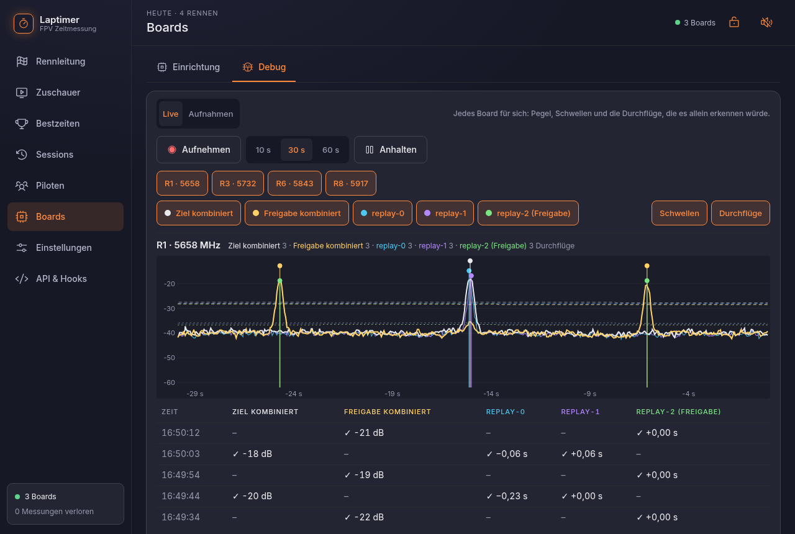
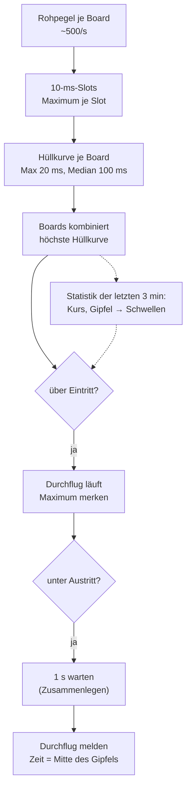

# Durchflug-Erkennung

Aus „Board 1 hat auf Kanal R3 um 12:03:17,512 −31 dBFS gemessen“ wird „Pilot auf R3 ist um
12:03:17,48 durchs Gate geflogen“. Die Erkennung (`server/src/detect.rs`) hat kein I/O. Sie
läuft live, auf Aufnahmen (`laptimer replay`) und in den Tests genau gleich.

## Eingang

Jedes Board misst reihum die eingestellten Kanäle, bei vier Kanälen jeden alle 2 ms (rund
500 Werte pro Sekunde). Ein Pegelcode hat 0,25 dB Auflösung: dBFS = code / 4 − 63,75.

{ .shot }

## Schritte pro Kanal



1. **Slots:** Die Zeit wird in 10-ms-Stücke geteilt; pro Board zählt der höchste Wert im
   Stück. DJI sendet in Paketen, und etwa jede fünfte Messung fällt in eine Sendepause, liest
   also nur Rauschen. Das Maximum übergeht diese Lücken (der Median täte es nicht).
2. **Hüllkurve:** pro Board das Maximum über 2 Slots (20 ms), davon der Median der letzten 10
   (100 ms) gegen kurze Spitzen.
3. **Boards kombinieren:** die höchste Hüllkurve aller Boards eines Gates. Sieht ein Board die
   Drohne kurz schlecht, sieht sie meist ein anderes.
4. **Schwellen aus dem Flug:**
    - **Kurs** = Median der Hüllkurve, solange der Sender an ist (über −46 dBFS), über die
      letzten 3 Minuten.
    - **Gipfel** = Median der letzten 5 Durchflug-Gipfel des Piloten; vor dem 3. Durchflug
      das 99,5-%-Perzentil der Pegel.
    - **Eintritt** = Kurs + 60 % von (Gipfel − Kurs), mindestens aber Kurs + **Mindestausschlag**
      (Standard 12 dB).
    - **Austritt** = Kurs + 20 % von (Gipfel − Kurs), mindestens 1 dB unter dem Eintritt.
5. **Zeitpunkt:** die Mitte des Bereichs, der höchstens 1 dB unter dem Maximum des
   Durchflugs liegt. Der Gipfel ist ein breiter Buckel; seine Mitte ist stabiler als der
   höchste Einzelwert.
6. **Zusammenlegen:** Gemeldet wird erst 1 s nach dem Austritt. Fällt der Pegel mitten im Gate
   kurz ab und steigt wieder, wird das so noch ein Durchflug. Näher als die Mindestrunde
   (Standard 3 s) am vorigen ist es derselbe.
7. **Anlauf und Zurücknehmen:** Bis ein Pilot drei Durchflüge hat, ist der Gipfel nur
   geschätzt, und die höchsten Momente der Strecke können zählen. Sobald drei echte Gipfel da
   sind, prüft der Detektor die frühen Durchflüge noch einmal und nimmt die zurück, die die
   echte Schwelle nicht erreicht hätten (`Event::Retract`). Der Server löscht sie dann aus der
   Datenbank.

## Warum der Mindestausschlag?

Gelernte Schwellen haben eine Schwäche: Stimmen die ersten Gipfel nicht, stimmt die Schwelle
nicht. In der ersten echten Session zählten mit 3 dB Mindestausschlag Wellen, die nur 4–5 dB
über dem Kurs lagen: 7 Treffer statt 2. Echte Durchflüge lagen in allen Aufnahmen 13–26 dB
über dem Kurs. In einer späteren Session flog ein Pilot oft 1–2 m über dem Gate; diese
Überflüge lagen etwa 14 dB darüber und brachten 8 Treffer; mit 12 dB blieben 3, mit 15 dB
ging auch ein echter Durchflug verloren.

Der Pegel allein trennt Überflüge und Durchflüge also nur knapp. Die verlässlichere Lösung
ist das [Freigabe-Gate](../funktionen/gates.md). Der Mindestausschlag ist pro Kanal
einstellbar, etwa für einen stärkeren Sender.

## Feste Schwellen

Pro Kanal und Gate kann statt „automatisch“ **manuell** gewählt werden: feste Eintritts- und
Austrittsschwelle in dBFS, wie EnterAt/ExitAt bei RotorHazard. Solche Kanäle lernen nichts
und nehmen nichts zurück. Feste Werte hängen am Aufbau (Abstand, Antennen) und am Gain der
Boards; als Preset gespeichert, merkt sich das Preset den Gain mit, und die Seite weist auf
einen anderen hin.

## Freigabe-Regel

Das Freigabe-Gate hat einen eigenen Detektor mit eigenen Einstellungen. Der Core prüft jeden
Ziel-Durchflug:

```text
wenn ein Freigabe-Board läuft
   und es nicht der erste Durchflug nach dem Start ist
   und seit dem letzten gezählten Durchflug dieses Kanals kein Freigabe-Durchflug kam:
       als gelöscht speichern (im Editor wiederherstellbar)
sonst:
       zählen
```

Freigabe-Durchflüge stehen mit `gate = 1` in der Datenbank und machen keine Runden.

## Nachträglich: Graph und Einrasten

Für den Editor läuft die Pegel-Datei der Session noch einmal durch einen Detektor mit den
Einstellungen der Session, der pro Slot die Hüllkurve, die Schwellen und Ein- und Austritte
aufzeichnet. Daraus macht `trace.rs` den Graph (pro Bildpunkt das Maximum, damit kein Gipfel
verloren geht). Tippt man neben einen Gipfel, sucht der Server den höchsten Punkt im Umkreis
von 1 s und nimmt dort, wie der Detektor, die Mitte des Bereichs innerhalb 1 dB.

Gemessen an einer Aufnahme: Ein Tipp bis 1 s neben dem Gipfel landet auf dem Zeitpunkt, den
auch die Erkennung bestimmt hätte; weiter weg 0,1–0,4 s daneben oder an einem anderen Buckel.
Deshalb zeigt die Seite die Stelle vor dem Einfügen.

## Selbst ausprobieren

```sh
laptimer replay aufnahme.csv               # Erkennung auf einer Aufnahme, alle Boards
laptimer replay aufnahme.csv --board 0     # nur ein Board
laptimer replay aufnahme.csv --min-rise 15 # anderer Mindestausschlag
```

Das Debug-Paket einer Session (Sessions → Export → Debug) enthält die Rohpegel, den Verlauf je
10 ms (`trace.csv`) und die Ereignisse der Neuberechnung (`detector_events.csv`), auch die
Zurücknahmen.
